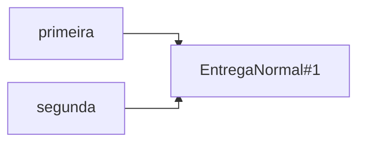
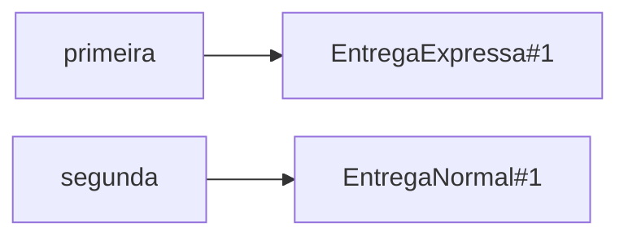
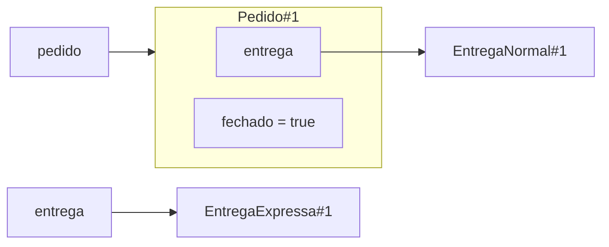

# Aula 15 — Polimorfismo: a mesma mensagem, comportamentos diferentes

Na Aula 14, `Pedido` passou a depender do contrato `Entrega`. Uma entrega normal,
uma expressa ou uma retirada podem ocupar esse papel, cada uma com sua regra.
Agora vamos acompanhar o que acontece quando o programa solicita uma operação
por esse contrato: qual objeto recebe a chamada e qual implementação executa?

**Slides:** [Apresentação HTML](../slides/rendered/aula-15-polimorfismo-a-mesma-mensagem-comportamentos-diferentes.html) · [PDF](../slides/rendered/aula-15-polimorfismo-a-mesma-mensagem-comportamentos-diferentes.pdf)

!!! lesson-question "Pergunta central"

    Como Java decide qual implementação executar quando a chamada é feita por
    uma referência de interface?

!!! lesson-objectives "Objetivos"

    Ao final deste estudo, você deverá ser capaz de:

    - explicar polimorfismo e despacho dinâmico a partir de uma colaboração;
    - distinguir as chamadas permitidas pelo tipo declarado da implementação
      executada pelo objeto;
    - acompanhar referências locais e campos sem confundir reatribuição com
      transformação do objeto;
    - avaliar o impacto de novas implementações sobre o cliente; e
    - transferir esse raciocínio para uma colaboração que altera estado.

!!! info "Uso de IA — Nível 1: Tutor"

    Faça as previsões antes de consultar ajuda. A IA pode esclarecer conceitos
    e mensagens de compilação; as explicações e análises propostas devem ser suas.

## A chamada permanece; o objeto muda

O contrato e as duas regras de custo são os conhecidos da aula anterior. Cada
tipo público fica em seu próprio arquivo `.java`:

```java
public interface Entrega {
    double calcularCusto(Pedido pedido);
}
```

```java
public class EntregaNormal implements Entrega {
    public double calcularCusto(Pedido pedido) {
        return 10.0;
    }
}
```

```java
public class EntregaExpressa implements Entrega {
    public double calcularCusto(Pedido pedido) {
        return 25.0;
    }
}
```

Esses custos são fixos. Embora recebam um `Pedido`, as duas implementações não
precisam consultar seus dados neste recorte. Podemos solicitar o cálculo
diretamente à entrega, sem fechar o pedido:

```java
Pedido pedido = new Pedido();
Entrega entrega = new EntregaNormal();

System.out.println(entrega.calcularCusto(pedido));

entrega = new EntregaExpressa();

System.out.println(entrega.calcularCusto(pedido));
```

!!! activity "Atividade — duas chamadas, uma declaração"

    1. Quais valores são impressos, na ordem?
    2. O tipo declarado de `entrega` muda depois da atribuição?
    3. Qual objeto recebe cada chamada a `calcularCusto(pedido)`?

??? "Ver resposta"

    1. `10.0` e `25.0`.
    2. Não. O tipo declarado continua sendo `Entrega`.
    3. A primeira chamada chega ao objeto `EntregaNormal`; a segunda chega ao
       objeto `EntregaExpressa` criado depois.

O texto da chamada é igual nas duas linhas. O contrato garante que podemos
solicitar `calcularCusto(Pedido)`, mas cada objeto executa a implementação da
sua classe. Declarar a variável como `Entrega` não faz Java ignorar qual objeto
ela alcança.

Isso ainda deixa uma dúvida importante: quando atribuímos outra referência à
variável, o que acontece com as referências que já existiam?

## Duas referências podem seguir caminhos diferentes

Agora temos duas variáveis declaradas como `Entrega`:

```java
Pedido pedido = new Pedido();
Entrega primeira = new EntregaNormal();
Entrega segunda = primeira;

primeira = new EntregaExpressa();

System.out.println(primeira.calcularCusto(pedido));
System.out.println(segunda.calcularCusto(pedido));
```

!!! activity "Atividade — acompanhe as referências"

    1. Quais valores são impressos?
    2. Quantos objetos de entrega foram criados?
    3. A atribuição a `primeira` transforma a entrega normal ou muda `segunda`?

??? "Ver resposta"

    1. `25.0` e `10.0`.
    2. Dois: um `EntregaNormal` e um `EntregaExpressa`. A linha
       `Entrega segunda = primeira` copia uma referência, sem criar outro objeto.
    3. Não. A atribuição muda somente a referência guardada em `primeira`.
       `segunda` continua apontando para o objeto normal.

Logo depois de `Entrega segunda = primeira`, as duas variáveis alcançam o
mesmo objeto:



Depois de `primeira = new EntregaExpressa()`, o estado das referências é:



As caixas com nomes de variáveis guardam referências; as setas significam
**aponta para**. Os rótulos `#1` distinguem instâncias no desenho e não
representam endereços de memória.

!!! trap "Armadilha — reatribuir não transforma o objeto"

    - A entrega normal não se tornou expressa: um novo objeto foi criado.
    - `segunda` não acompanha futuras atribuições a `primeira`: cada variável
      guarda sua própria referência.

Para prever cada resultado, seguimos a referência usada naquela chamada até
o objeto. Esse caminho explica por que duas variáveis do mesmo tipo podem
produzir comportamentos diferentes.

## Dar nome ao que acabamos de observar

Nas duas investigações, objetos de classes diferentes puderam receber a mesma
solicitação por referências declaradas com o tipo `Entrega`. O código que faz
a chamada não precisou escolher uma fórmula a partir do nome da classe.

!!! conceito-chave "Conceito-chave — polimorfismo"

    Polimorfismo permite usar objetos de classes diferentes por um mesmo tipo
    e solicitar a mesma operação, cuja implementação é escolhida conforme o
    objeto que recebe a chamada.

O nome **despacho dinâmico** descreve essa escolha durante a execução. Na chamada
`entrega.calcularCusto(pedido)`, Java chega ao objeto referenciado por `entrega`
e executa sua implementação do método de instância.

No nosso exemplo:

| Tipo declarado da referência | Classe do objeto alcançado | Implementação executada | Resultado |
| --- | --- | --- | ---: |
| `Entrega` | `EntregaNormal` | `EntregaNormal.calcularCusto` | `10.0` |
| `Entrega` | `EntregaExpressa` | `EntregaExpressa.calcularCusto` | `25.0` |

“Mesma operação” não significa que todas as chamadas sempre retornam o mesmo
valor, nem exige que os resultados sejam diferentes. O que importa é poder
solicitar a operação pelo tipo comum e cada objeto executar sua implementação.

Se o objeto determina a implementação, precisamos ainda entender um limite:
isso permite solicitar qualquer método que exista nele?

## O objeto tem o método; a referência permite a chamada?

Considere que `EntregaExpressa` também oferece uma operação pública específica:

```java
public void priorizarNaFila() {
    System.out.println("Entrega priorizada");
}
```

Esse método pertence a `EntregaExpressa`, mas não foi declarado em `Entrega`.
Analise as duas chamadas abaixo separadamente. A linha indicada como inválida
impede a compilação do trecho se for mantida:

```java
Pedido pedido = new Pedido();
Entrega entrega = new EntregaExpressa();

entrega.calcularCusto(pedido); // compila
entrega.priorizarNaFila();    // não compila
```

!!! activity "Atividade — concilie compilação e execução"

    1. Se o objeto possui `priorizarNaFila()`, por que a segunda chamada falha?
    2. A chamada compilaria com a declaração
       `EntregaExpressa expressa = new EntregaExpressa()` e o uso de
       `expressa.priorizarNaFila()`?
    3. Retirando a linha inválida, qual implementação de `calcularCusto` executa?

??? "Ver resposta"

    1. O tipo declarado de `entrega` é `Entrega`. A operação específica não
       está disponível por esse tipo, mesmo existindo no objeto alcançado.
    2. Sim. `EntregaExpressa` oferece essa operação pública.
    3. A implementação de `EntregaExpressa`, que devolve `25.0`.

!!! java-focus "Java em foco — duas perguntas em momentos diferentes"

    - **Na compilação:** o tipo declarado da referência permite essa chamada?
    - **Na execução:** qual objeto a referência alcança e qual implementação
      do método de instância ele executa?

O despacho dinâmico explica como uma chamada válida executa. Ele não torna
válida uma chamada que o compilador recusou. Também não faz o objeto perder
as operações que existem em sua classe.

## A variável mudou; e a entrega guardada no pedido?

Até aqui, chamamos as entregas diretamente. Agora vamos acompanhar a colaboração
completa. Este é o recorte de `Pedido` que permanece da Aula 14:

```java
private Entrega entrega;
private boolean fechado;

public void fechar(Entrega entrega) {
    if (!fechado && entrega != null) {
        this.entrega = entrega;
        fechado = true;
    }
}

public double calcularCustoEntrega() {
    return entrega.calcularCusto(this);
}
```

O pedido começa aberto e sem entrega. Neste estudo, a consulta ao custo por
`Pedido` ocorre depois de um fechamento válido. A chamada encaminha o próprio
pedido como argumento, por meio de `this`.

```java
Entrega entrega = new EntregaNormal();
Pedido pedido = new Pedido();
pedido.fechar(entrega);

entrega = new EntregaExpressa();

System.out.println(entrega.calcularCusto(pedido));
System.out.println(pedido.calcularCustoEntrega());
```

!!! activity "Atividade — siga o campo e a variável local"

    1. Quais são os dois valores impressos?
    2. Qual objeto recebe `calcularCustoEntrega()`? Qual recebe
       `calcularCusto(this)` dentro desse método?
    3. Qual atribuição seria necessária para mudar o campo do pedido? Ela
       aconteceu depois da criação da entrega expressa?

??? "Ver resposta"

    1. `25.0` e `10.0`.
    2. O objeto `Pedido` recebe `calcularCustoEntrega()`. Dentro dele, a chamada
       `calcularCusto(this)` chega à entrega normal guardada no campo `entrega`.
    3. Seria necessária uma atribuição ao campo do pedido, como
       `this.entrega = entrega` dentro de um método daquele objeto. A atribuição
       posterior mudou somente a variável local, sem executar essa alteração.

Após a reatribuição local, o estado relevante é:



O campo está dentro de `Pedido`; a variável local está fora dele. O fato de
ambos se chamarem `entrega` não os transforma no mesmo lugar de armazenamento.

### Aceitar outro tipo não muda a regra do fechamento

Continue o mesmo cenário, agora tentando fornecer a entrega expressa ao pedido:

```java
pedido.fechar(entrega);
System.out.println(pedido.calcularCustoEntrega());
```

Preveja o resultado. A chamada compila? O campo passa a apontar para a expressa?

??? "Ver resposta"

    - A chamada compila: a referência tem tipo `Entrega` e alcança um objeto
      que cumpre esse contrato.
    - O pedido já está fechado. A guarda `!fechado` é falsa e impede a atribuição
      ao campo.
    - O custo continua sendo `10.0`, calculado pela entrega normal.

!!! trap "Armadilha — polimorfismo não troca o colaborador por conta própria"

    - Uma referência local pode mudar sem alterar o campo de outro objeto.
    - Receber um argumento de tipo aceito não obriga o método a armazená-lo.
    - O despacho usa o objeto alcançado pela referência da chamada; as regras
      de `Pedido` continuam controlando qual entrega permanece guardada.

Podemos proteger esse comportamento com um teste. Em uma classe de testes com
JUnit Jupiter configurado:

```java
import org.junit.jupiter.api.Test;
import static org.junit.jupiter.api.Assertions.assertEquals;

class PedidoTest {
    @Test
    void reatribuirVariavelNaoTrocaEntregaDoPedido() {
        Entrega entrega = new EntregaNormal();
        Pedido pedido = new Pedido();
        pedido.fechar(entrega);

        entrega = new EntregaExpressa();

        assertEquals(25.0, entrega.calcularCusto(pedido));
        assertEquals(10.0, pedido.calcularCustoEntrega());
    }
}
```

As duas expectativas distinguem a variável local do campo guardado. O teste
verifica esse cenário; um segundo fechamento exige uma chamada e uma expectativa
próprias se também quisermos protegê-lo.

## Quem precisa conhecer cada alternativa?

Uma proposta para calcular o custo dentro de `Pedido` seria identificar a
modalidade e escolher a fórmula ali. Este esboço está em linguagem natural,
não em Java:

```text
se a modalidade for normal: devolver 10
senão, se for expressa: devolver 25
senão, se for retirada local: devolver 0
```

Na solução pelo contrato, o pedido mantém:

```java
return entrega.calcularCusto(this);
```

!!! activity "Atividade — uma entrega agendada chega ao sistema"

    A nova `EntregaAgendada` deve calcular um custo fixo de `15.0`.

    1. Na proposta com condicionais dentro de `Pedido`, onde seria necessário
       acrescentar a regra?
    2. Na colaboração pelo contrato, quem implementa o cálculo e quais partes
       de `Pedido` precisam mudar?
    3. Se `Pedido` não identifica a classe, quem escolhe a entrega utilizada?

??? "Ver uma análise possível"

    1. Na seleção de modalidades dentro de `Pedido`, acrescentando outro caso.
    2. `EntregaAgendada` cumpre `Entrega` e implementa `calcularCusto(Pedido)`
       devolvendo `15.0`. Campo, fechamento e consulta do pedido permanecem iguais.
    3. O código que monta o cenário, como `Main`, cria a entrega desejada e a
       fornece ao pedido. Essa escolha continua existindo fora do cálculo.

O ganho está na distribuição das responsabilidades: o cliente solicita a
operação pelo contrato; cada implementação conhece sua regra. Condicionais
continuam úteis para regras do domínio, como impedir outro fechamento. Aqui,
identificar novamente a modalidade dentro de `Pedido` espalharia uma decisão
que já pode ser realizada pela colaboração.

## A mesma operação em um percurso de objetos diferentes

Até aqui, cada chamada apareceu separadamente. Podemos reunir várias entregas
em uma lista para consultar suas regras em sequência. Isso não representa um
pedido fechado com várias entregas: é uma comparação direta dos custos das
alternativas para o mesmo pedido.

No `main`, retomamos `List`, `ArrayList`, `add` e o laço da Aula 07. Agora o tipo
dos elementos é o contrato `Entrega`:

```java
import java.util.ArrayList;
import java.util.List;
```

```java
Pedido pedido = new Pedido();
List<Entrega> alternativas = new ArrayList<>();

alternativas.add(new EntregaNormal());
alternativas.add(new EntregaExpressa());

for (Entrega entrega : alternativas) {
    System.out.println(entrega.calcularCusto(pedido));
}
```

Preveja a saída. O tipo declarado de `entrega` precisa mudar a cada passagem?
Precisamos perguntar se o elemento é uma entrega normal ou expressa?

??? "Ver resposta"

    - A saída é `10.0` e depois `25.0`, seguindo a ordem de inclusão na lista.
    - A variável do laço continua declarada como `Entrega`. Em cada passagem,
      ela referencia o objeto correspondente àquela posição.
    - O corpo do laço solicita a mesma operação pelo contrato. O despacho
      dinâmico chega à implementação do objeto atual, sem identificar sua classe
      por condicionais.

!!! java-focus "Java em foco — uma lista de referências pelo contrato"

    - `List<Entrega>` admite referências para objetos que cumprem `Entrega`.
    - `for (Entrega entrega : alternativas)` percorre os elementos na ordem
      da lista, usando o mesmo tipo declarado para o elemento atual.
    - Uma lista vazia não executa o corpo do laço. Se o mesmo objeto aparecer
      em duas posições, receberá a chamada duas vezes.

A inclusão de uma entrega agendada na lista muda os objetos percorridos; a
chamada dentro do laço pode permanecer igual. Esse raciocínio será aplicado no
Laboratório 15 para enviar um lembrete por uma sequência de canais.

## Transferência — a mesma chamada pode alterar estado

Até agora, as entregas devolveram custos. Vamos investigar outra consequência
de uma chamada: alterar o estado de um objeto em um pequeno jogo.

Um personagem começa com **50 pontos de vida**. Uma poção recupera 20 pontos;
uma armadilha retira 10. O personagem controla sua vida, enquanto cada efeito
decide o que solicitar a ele. Neste recorte, usamos somente os valores
apresentados, sem outras regras de limites de vida ou morte.

O contrato descreve a capacidade comum. Em `Efeito.java`:

```java
public interface Efeito {
    void aplicarEm(Personagem personagem);
}
```

Em `Personagem.java`:

```java
public class Personagem {
    private int vida;

    public Personagem() {
        vida = 50;
    }

    public int getVida() {
        return vida;
    }

    public void recuperarVida(int pontos) {
        vida += pontos;
    }

    public void perderVida(int pontos) {
        vida -= pontos;
    }

    public void receber(Efeito efeito) {
        efeito.aplicarEm(this);
    }
}
```

Cada classe de efeito fica em seu próprio arquivo:

```java
public class Pocao implements Efeito {
    public void aplicarEm(Personagem personagem) {
        personagem.recuperarVida(20);
    }
}
```

```java
public class Armadilha implements Efeito {
    public void aplicarEm(Personagem personagem) {
        personagem.perderVida(10);
    }
}
```

### Acompanhar quem recebe cada chamada

Considere este cenário no `main`:

```java
Personagem personagem = new Personagem();
Efeito efeito = new Pocao();

personagem.receber(efeito);
System.out.println(personagem.getVida());

efeito = new Armadilha();

personagem.receber(efeito);
System.out.println(personagem.getVida());
```

!!! activity "Atividade — reconstrua o caminho até a mudança de vida"

    1. Quais valores são impressos?
    2. Na primeira chamada, quem recebe `receber(...)`, quem recebe
       `aplicarEm(...)` e quem recebe `recuperarVida(20)`?
    3. O que `this` representa dentro de `Personagem.receber(...)`?
    4. Na segunda chamada, por que o mesmo código de `receber(...)` provoca
       outro efeito? Qual objeto tem seu estado alterado?

??? "Ver resposta"

    1. `70` e `60`. O mesmo personagem ganha 20 pontos e depois perde 10.
    2. O personagem recebe `receber(...)`; a poção recebe `aplicarEm(...)`;
       o personagem recebe `recuperarVida(20)`.
    3. O próprio personagem que recebeu a chamada. Esse objeto é passado
       como argumento para o efeito.
    4. O parâmetro agora referencia uma armadilha. Sua implementação de
       `aplicarEm` solicita `perderVida(10)` ao personagem. O estado alterado
       continua sendo a vida do personagem.

O percurso da primeira chamada pode ser lido nesta sequência:

```text
Main solicita receber(poção) ao personagem
Personagem solicita aplicarEm(personagem) à poção
Pocao solicita recuperarVida(20) ao personagem
Personagem altera sua vida de 50 para 70
```

Desenhe o percurso correspondente à segunda chamada, incluindo a vida antes
e depois da aplicação.

??? "Ver um percurso possível"

    ```text
    Main solicita receber(armadilha) ao personagem
    Personagem solicita aplicarEm(personagem) à armadilha
    Armadilha solicita perderVida(10) ao personagem
    Personagem altera sua vida de 70 para 60
    ```

`receber(...)` usa o efeito passado naquela chamada e não o guarda em um campo.
Na próxima chamada, pode receber outro objeto. Já `Pedido` conserva a entrega
fornecida no primeiro fechamento válido. Essa diferença vem dos métodos e das
regras dos dois modelos.

### Avaliar uma proposta de solução

Uma sugestão para o jogo afirma: “Dentro de `receber`, precisamos descobrir se
o efeito é poção ou armadilha para escolher o que fazer.”

Essa identificação é necessária? Explique como a versão atual chega ao
comportamento correto e quem controla a alteração da vida.

??? "Ver uma análise possível"

    - A identificação é desnecessária nessa colaboração: o parâmetro `Efeito`
      permite solicitar `aplicarEm(this)`.
    - O objeto recebido determina a implementação executada. A poção solicita
      recuperação; a armadilha solicita perda.
    - O personagem continua controlando seu campo privado. Cada efeito usa
      operações públicas do personagem, sem alterar o campo diretamente.

### Uma nova implementação, sem reescrever o personagem

Surge uma `FonteDeCura` que recupera **5 pontos**. Parta do mesmo personagem,
que terminou a sequência anterior com 60 pontos de vida.

!!! activity "Atividade — incorpore a fonte de cura"

    1. Que contrato a nova classe deve cumprir e que operação deve implementar?
    2. Qual solicitação ela deve fazer ao personagem?
    3. O corpo de `receber(...)` ou o contrato `Efeito` precisa mudar?
    4. Onde o novo objeto é criado e qual será a vida depois de recebê-lo?

??? "Ver uma solução possível"

    1. A classe cumpre `Efeito` e implementa `public void aplicarEm(Personagem)`.
    2. Solicita `recuperarVida(5)` ao personagem recebido:

        ```java
        public class FonteDeCura implements Efeito {
            public void aplicarEm(Personagem personagem) {
                personagem.recuperarVida(5);
            }
        }
        ```

    3. Não. Ambos já expressam a colaboração necessária.
    4. O código que monta o cenário cria e fornece a fonte, por exemplo no `main`:

        ```java
        personagem.receber(new FonteDeCura());
        System.out.println(personagem.getVida()); // 65
        ```

## O que torna a mesma chamada capaz de produzir efeitos diferentes?

A chamada `efeito.aplicarEm(this)` é válida porque o parâmetro tem tipo
`Efeito`. Durante a execução, o objeto alcançado pode ser uma poção, uma
armadilha ou uma fonte de cura. Sua implementação determina a solicitação feita
ao personagem. O cliente pode continuar usando a mesma operação.

!!! synthesis "Síntese"

    - O tipo declarado permite verificar quais chamadas podem ser feitas.
    - O objeto que recebe a chamada determina a implementação do método de
      instância executada por despacho dinâmico.
    - Reatribuir uma variável não transforma objetos nem atualiza outras
      referências automaticamente.
    - Polimorfismo não modifica as regras que determinam quando um colaborador
      é recebido, usado ou guardado.
    - A mesma colaboração pode devolver valores ou provocar mudanças de estado;
      o contrato permite a chamada e cada implementação realiza seu comportamento.

A análise das situações seguiu quatro passos: verificar se o tipo declarado
permite a chamada, localizar o objeto que a recebe, identificar a implementação
executada e acompanhar o resultado ou a mudança de estado. O nome da variável,
sozinho, não fornece essas respostas.

No [Laboratório 15](laboratorio-15-a-mesma-chamada-varios-canais.md), o Projeto 2
passará a enviar a mensagem de um lembrete por uma sequência de notificadores,
contando cada envio e preservando o canal inicial.

## Materiais relacionados

- [Aula 14 — Do colaborador concreto ao contrato](aula-14-do-colaborador-concreto-ao-contrato.md)
- [Laboratório 14 — Um contrato para os avisos](laboratorio-14-um-contrato-para-os-avisos.md)
- [Laboratório 15 — A mesma chamada, vários canais](laboratorio-15-a-mesma-chamada-varios-canais.md)
- [Java essencial para quem já sabe programar](../materiais/java-essencial.md)
