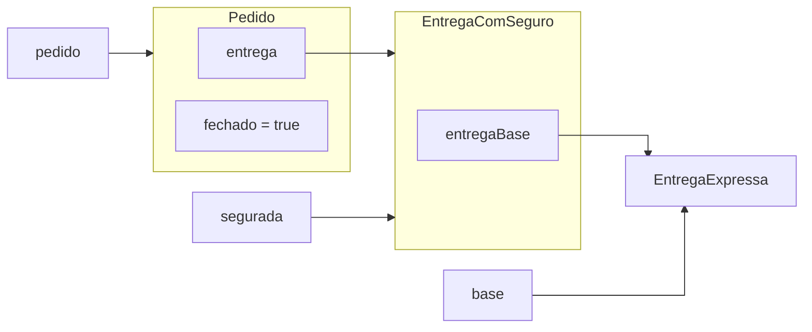

# Aula 16 — Combinando comportamentos por composição

<!-- Artifact identity: lesson-poo-aula-16 -->

Na Aula 15, acompanhamos a mesma chamada chegando a implementações diferentes.
Agora surge outra necessidade: oferecer seguro tanto para a entrega normal
quanto para a expressa. Vamos investigar como acrescentar esse comportamento
aproveitando as regras que cada entrega já conhece.

**Slides:** [Apresentação HTML](../slides/rendered/aula-16-combinando-comportamentos-por-composicao.html) · [PDF](../slides/rendered/aula-16-combinando-comportamentos-por-composicao.pdf)

!!! lesson-question "Pergunta central"

    Como acrescentar um comportamento a diferentes implementações sem repetir
    suas regras nem modificar o cliente que as utiliza?

!!! lesson-objectives "Objetivos"

    Ao final deste estudo, você deverá ser capaz de:

    - combinar comportamentos distribuindo responsabilidades entre objetos;
    - distinguir cumprir um contrato de guardar um colaborador desse contrato;
    - reconstruir o caminho das chamadas e dos resultados em uma delegação;
    - analisar o impacto de novas combinações sobre o cliente; e
    - verificar o resultado e a colaboração com testes.

!!! info "Uso de IA — Nível 1: Tutor"

    Faça suas previsões antes de consultar ajuda. A IA pode esclarecer conceitos
    e mensagens de compilação; as análises propostas devem ser suas.

## O seguro depende de qual modalidade?

O sistema continua usando o contrato conhecido. Cada tipo público apresentado
na aula fica em seu próprio arquivo `.java`:

```java
public interface Entrega {
    double calcularCusto(Pedido pedido);
}
```

```java
public class EntregaNormal implements Entrega {
    public double calcularCusto(Pedido pedido) {
        return 10.0;
    }
}
```

```java
public class EntregaExpressa implements Entrega {
    public double calcularCusto(Pedido pedido) {
        return 25.0;
    }
}
```

Para esta investigação, o seguro é opcional e **acrescenta R$ 5 ao custo da
modalidade escolhida**. Normal e expressa continuam disponíveis sem seguro.
O cálculo não contrata serviços, não cobra valores e não altera o pedido.
Também não depende do conteúdo dos itens neste recorte.

| Escolha | Cálculo esperado |
| --- | ---: |
| Normal sem seguro | `10.0` |
| Expressa sem seguro | `25.0` |
| Normal com seguro | `10.0 + 5.0` |
| Expressa com seguro | `25.0 + 5.0` |

Uma proposta é criar `EntregaNormalComSeguro` e `EntregaExpressaComSeguro`,
copiando para cada uma o custo de sua modalidade e somando `5.0`. Outra é
fazer `Pedido` descobrir a modalidade e calcular o acréscimo.

!!! activity "Atividade — onde cada regra deve ficar?"

    Considere as duas propostas e as responsabilidades atuais.

    1. Se o custo da entrega normal mudar, que regra ficaria repetida na
       primeira proposta?
    2. Na segunda proposta, que conhecimento novo `Pedido` precisaria ter?
    3. Para calcular o custo com seguro, quais duas tarefas podem ser separadas?

??? "Ver uma análise possível"

    1. O custo normal apareceria em `EntregaNormal` e na versão que copiou essa
       fórmula para incluir seguro. Seria necessário manter as duas coerentes.
    2. Precisaria conhecer modalidades e a regra de acréscimo, além de coordenar
       o pedido e conservar sua entrega escolhida.
    3. Calcular o custo da modalidade e acrescentar o valor do seguro. A entrega
       existente já sabe realizar a primeira tarefa.

O comportamento adicional precisa de um custo-base. Não precisa refazer a regra
que produz esse custo. Podemos solicitar esse trabalho a um objeto existente.

## Um objeto acrescenta; outro calcula a base

`EntregaComSeguro` guarda uma referência para a entrega escolhida. Quando recebe
uma solicitação de custo, pede o cálculo a essa entrega e acrescenta `5.0`:

```java
public class EntregaComSeguro implements Entrega {
    private Entrega entregaBase;

    public EntregaComSeguro(Entrega entregaBase) {
        this.entregaBase = entregaBase;
    }

    public double calcularCusto(Pedido pedido) {
        double custoBase = entregaBase.calcularCusto(pedido);
        return custoBase + 5.0;
    }
}
```

Considere colaboradores diferentes de `null`, como nos cenários anteriores.
A classe guarda a entrega recebida, sem criar outra modalidade por conta própria.

Há duas decisões distintas nessa declaração:

| Trecho | Papel |
| --- | --- |
| `implements Entrega` | permite que o novo objeto seja usado onde o contrato `Entrega` é esperado |
| `private Entrega entregaBase` | permite que ele conserve e use outro objeto para calcular a base |

O método implementado pertence a `EntregaComSeguro`. Dentro dele existe uma
chamada a **outro objeto**, alcançado pelo campo `entregaBase`.

!!! activity "Atividade — a mesma classe, duas combinações"

    Neste cenário, as consultas são feitas diretamente às entregas. O pedido
    é apenas o argumento exigido pelo contrato; não precisa estar fechado.

    ```java
    Pedido pedido = new Pedido();
    Entrega normal = new EntregaNormal();
    Entrega normalSegurada = new EntregaComSeguro(normal);
    Entrega expressaSegurada =
            new EntregaComSeguro(new EntregaExpressa());

    System.out.println(normalSegurada.calcularCusto(pedido));
    System.out.println(expressaSegurada.calcularCusto(pedido));
    System.out.println(normal.calcularCusto(pedido));
    ```

    1. Quais são os três valores impressos, na ordem?
    2. Qual objeto calcula a base na segunda impressão?
    3. Criar `normalSegurada` alterou o objeto referenciado por `normal`?

??? "Ver resposta"

    1. `15.0`, `30.0` e `10.0`.
    2. O objeto `EntregaExpressa` fornecido ao construtor. Ele devolve `25.0`;
       o objeto `EntregaComSeguro` acrescenta `5.0`.
    3. Não. Foi criado outro objeto, que guarda uma referência para a entrega
       normal. A normal continua realizando sua própria regra de `10.0`.

O custo com seguro resulta da colaboração entre dois objetos. A mesma classe
adicional pode ser combinada com modalidades diferentes porque depende de
`Entrega`, sem nomear a classe que calcula a base.

!!! conceito-chave "Conceito-chave — composição de comportamentos e delegação"

    - Compor comportamentos é combinar o trabalho de objetos para realizar
      uma responsabilidade maior.
    - Delegar é solicitar a um colaborador parte do trabalho necessário.
    - Aqui, a entrega-base calcula sua modalidade e `EntregaComSeguro`
      acrescenta o seguro ao resultado.

Na Aula 08, analisamos composição como responsabilidade por partes estruturais
de um todo, como os itens de um pedido. Aqui, o foco é a combinação de
comportamentos por colaboração. Guardar a entrega-base não estabelece posse
exclusiva: o cenário anterior ainda permite usá-la diretamente.

## O pedido recebe uma entrega; o cálculo passa por duas

O papel público de `EntregaComSeguro` permite fornecê-la ao pedido. Mantemos as
operações conhecidas de `Pedido`:

```java
private Entrega entrega;

public void fechar(Entrega entrega) {
    if (!fechado && entrega != null) {
        this.entrega = entrega;
        fechado = true;
    }
}

public double calcularCustoEntrega() {
    return entrega.calcularCusto(this);
}
```

`Pedido` continua nascendo aberto e conserva a entrega no primeiro fechamento
válido. Toda consulta por `calcularCustoEntrega()` nesta aula ocorre depois
desse fechamento. O total dos itens continua sendo outro cálculo.

Monte o cenário:

```java
Entrega base = new EntregaExpressa();
Entrega segurada = new EntregaComSeguro(base);
Pedido pedido = new Pedido();
pedido.fechar(segurada);
```

O diagrama destaca somente as referências relevantes:



As setas representam referências. O campo do pedido alcança o objeto com seguro;
o campo desse objeto alcança a expressa. A variável `base` também alcança essa
mesma expressa, sem criar uma cópia.

!!! activity "Atividade — reconstrua um cálculo completo"

    Depois da montagem anterior, executamos:

    ```java
    System.out.println(pedido.calcularCustoEntrega());
    ```

    1. Que objeto recebe a chamada feita dentro de
       `Pedido.calcularCustoEntrega()`?
    2. Que objeto recebe a chamada feita dentro de
       `EntregaComSeguro.calcularCusto(...)`?
    3. Que valor cada entrega devolve, até chegar à impressão?
    4. O parâmetro `pedido` da entrega-base recebe um novo pedido ou o mesmo
       objeto que iniciou a consulta?

??? "Ver resposta"

    1. O objeto `EntregaComSeguro` guardado pelo pedido.
    2. O objeto `EntregaExpressa` guardado no campo `entregaBase`.
    3. A expressa devolve `25.0`. A entrega com seguro devolve `30.0`.
       O pedido devolve esse `30.0`, que é impresso.
    4. O mesmo objeto `Pedido`. O argumento recebido é repassado ao colaborador;
       não existe `new Pedido()` no caminho do cálculo.

O percurso pode ser lido assim:

```text
Main solicita calcularCustoEntrega() ao pedido
Pedido solicita calcularCusto(this) à entrega com seguro
EntregaComSeguro solicita calcularCusto(pedido) à entrega expressa
EntregaExpressa devolve 25.0
EntregaComSeguro acrescenta 5.0 e devolve 30.0
Pedido devolve 30.0
Main imprime 30.0
```

O polimorfismo participa de duas chamadas. Primeiro, o campo `entrega` do pedido
alcança uma `EntregaComSeguro`. Depois, o campo `entregaBase` alcança uma
`EntregaExpressa`. O contrato permite as chamadas; cada objeto executa sua
implementação.

### Reatribuir a variável não remonta a colaboração

Continue com **os mesmos objetos e o pedido fechado** do cenário anterior:

```java
base = new EntregaNormal();
System.out.println(pedido.calcularCustoEntrega());

pedido.fechar(base);
System.out.println(pedido.calcularCustoEntrega());
```

Quais são os dois valores impressos? Para cada linha, explique o que aconteceu
com os campos `entrega` do pedido e `entregaBase` do objeto com seguro.

??? "Ver resposta"

    - Ambos são `30.0`.
    - A reatribuição muda a variável local `base`. O campo `entregaBase`
      continua apontando para a expressa, e `entrega` continua apontando para
      o objeto com seguro.
    - O segundo fechamento é recusado pela guarda de `Pedido`. Nenhum desses
      dois campos é substituído.

Criar a combinação, escolher onde ela será usada e realizar seu cálculo são
responsabilidades diferentes. A composição respeita as regras de estado que
o pedido já possuía.

## A solução realmente usa o colaborador recebido?

Uma implementação pode parecer correta em um cenário e ainda ignorar a
colaboração necessária. Compare estas duas propostas para o **corpo** de
`EntregaComSeguro.calcularCusto(Pedido pedido)`:

```java
// Proposta A
return 10.0 + 5.0;
```

```java
// Proposta B
Entrega normal = new EntregaNormal();
return normal.calcularCusto(pedido) + 5.0;
```

!!! activity "Atividade — um resultado certo pode esconder uma decisão errada"

    O construtor continua recebendo e guardando `entregaBase` nas duas propostas.

    1. Que resultado cada proposta produz quando recebe uma normal?
    2. Que resultado cada uma produz quando recebe uma expressa? Qual seria
       o resultado exigido?
    3. Por que a proposta B ainda falha, mesmo chamando outro objeto?
    4. Que campo deve ser usado para respeitar a escolha feita pelo cliente?

??? "Ver resposta"

    1. As duas produzem `15.0`, conforme o esperado nesse único caso.
    2. Ambas continuam produzindo `15.0`, mas a expressa segurada deveria
       custar `30.0`.
    3. Ela cria uma normal em vez de usar a entrega recebida. O colaborador
       escolhido é ignorado.
    4. `entregaBase`, com a chamada `entregaBase.calcularCusto(pedido)`.

Agora surge `EntregaAgendada`, que cumpre `Entrega` e devolve `15.0`, como na
Aula 14. Queremos oferecê-la com seguro. Indique o custo esperado e os pontos
de mudança: a classe da modalidade, o código que monta a combinação,
`EntregaComSeguro` e `Pedido`.

??? "Ver uma análise possível"

    - A entrega agendada segurada custa `20.0`.
    - A modalidade precisa oferecer sua regra de `15.0` pelo contrato.
    - O código de montagem cria a combinação e a fornece ao pedido:

        ```java
        Entrega baseAgendada = new EntregaAgendada();
        Entrega agendadaSegurada = new EntregaComSeguro(baseAgendada);
        Pedido outroPedido = new Pedido();
        outroPedido.fechar(agendadaSegurada);
        ```

    - `EntregaComSeguro` continua solicitando o custo e somando `5.0`.
    - `Pedido` continua usando `Entrega`. Sua implementação permanece igual.

O contrato permite reutilizar a colaboração. Algum código ainda escolhe e monta
os objetos concretos; essa escolha não precisa aparecer no cálculo de `Pedido`
nem na regra do seguro.

## Como verificar o cálculo e a delegação?

Os testes anteriores continuam necessários. Acrescentamos expectativas para a
combinação, usando a implementação correta de `EntregaComSeguro`:

```java
import org.junit.jupiter.api.Test;
import static org.junit.jupiter.api.Assertions.assertEquals;

class EntregaComSeguroTest {
    @Test
    void acrescentaSeguroAoCustoExpresso() {
        Pedido pedido = new Pedido();
        pedido.fechar(new EntregaComSeguro(new EntregaExpressa()));

        assertEquals(30.0, pedido.calcularCustoEntrega());
    }

    @Test
    void consultasNaoAcumulamSeguroNemAlteramBase() {
        Pedido pedido = new Pedido();
        Entrega base = new EntregaNormal();
        Entrega segurada = new EntregaComSeguro(base);

        assertEquals(15.0, segurada.calcularCusto(pedido));
        assertEquals(15.0, segurada.calcularCusto(pedido));
        assertEquals(10.0, base.calcularCusto(pedido));
    }
}
```

O seguro faz parte do resultado de **cada consulta**. Não existe um campo que
some `5.0` a cada execução. Por isso, duas consultas não fazem o custo crescer.

O primeiro teste distinguiria as propostas A e B da implementação correta?
O segundo, sozinho, também distinguiria?

??? "Ver resposta"

    - O primeiro detectaria as duas propostas: ambas devolvem `15.0` para a
      expressa segurada, mas o teste espera `30.0`.
    - O segundo não as distinguiria: nos cenários com normal, ambas produzem
      os valores esperados. A escolha dos dados determina o que o teste detecta.

### Tornar a colaboração observável

Também podemos fornecer uma implementação de `Entrega` que registra como foi
usada. Ela serve de apoio ao teste, sem enviar nada nem depender de uma
modalidade real. Em `EntregaRegistrada.java`:

```java
public class EntregaRegistrada implements Entrega {
    private double custo;
    private int quantidadeCalculos;
    private Pedido ultimoPedido;

    public EntregaRegistrada(double custo) {
        this.custo = custo;
    }

    public double calcularCusto(Pedido pedido) {
        quantidadeCalculos++;
        ultimoPedido = pedido;
        return custo;
    }

    public int getQuantidadeCalculos() {
        return quantidadeCalculos;
    }

    public Pedido getUltimoPedido() {
        return ultimoPedido;
    }
}
```

O objeto recebe um custo conhecido e guarda a quantidade de solicitações e o
último pedido recebido. São campos, métodos e um contrato, como nas demais
classes. No mesmo `EntregaComSeguroTest`, acrescentamos:

```java
@Test
void delegaUmaVezComOMesmoPedido() {
    Pedido pedido = new Pedido();
    EntregaRegistrada base = new EntregaRegistrada(40.0);
    Entrega segurada = new EntregaComSeguro(base);

    double custo = segurada.calcularCusto(pedido);

    assertEquals(45.0, custo);
    assertEquals(1, base.getQuantidadeCalculos());
    assertEquals(true, base.getUltimoPedido() == pedido);
}
```

Quais informações o teste verifica além do custo final? Uma solução que
solicite o cálculo duas vezes e devolva apenas o segundo resultado mais `5.0`
passaria neste teste?

??? "Ver resposta"

    - Verifica uma única solicitação ao colaborador e a identidade do pedido
      recebido. `==` compara referências, como nas aulas anteriores.
    - Não. O custo poderia ser `45.0`, mas a quantidade de cálculos seria `2`,
      diferente do `1` esperado.

O contrato permite fornecer um colaborador que torna a interação observável.
Isso ajuda a verificar se o objeto usa a base escolhida, quantas vezes a usa
e que argumento fornece.

## A mesma ideia pode combinar ações sem devolver um valor

Retome o jogo da Aula 15. `Personagem` começa com `50` pontos, oferece
`recuperarVida(int)` e `perderVida(int)` e recebe um efeito desta forma:

```java
public void receber(Efeito efeito) {
    efeito.aplicarEm(this);
}
```

O contrato continua sendo:

```java
public interface Efeito {
    void aplicarEm(Personagem personagem);
}
```

`Pocao` recupera `20` pontos; `Armadilha` retira `10`. Neste exercício, queremos
combinar qualquer um deles com uma recuperação adicional de `5` pontos,
**realizada depois do efeito recebido**. Usamos somente esses valores, sem
novas regras de limites de vida ou morte.

!!! activity "Atividade — distribua as duas ações"

    Proponha uma classe `EfeitoComRecuperacao` que receba um `Efeito` na criação.

    1. Que contrato ela deve cumprir para ser recebida pelo personagem?
    2. Que colaborador deve guardar e o que deve solicitar a ele?
    3. Que ação deve realizar depois dessa solicitação?
    4. Em dois cenários independentes, cada um com personagem novo de `50`
       pontos, qual é a vida após receber a combinação com poção e com armadilha?

??? "Ver uma solução possível"

    1. Deve cumprir `Efeito`.
    2. Guarda o efeito recebido e solicita `aplicarEm(personagem)` a ele,
       repassando o mesmo personagem.
    3. Solicita `recuperarVida(5)` ao personagem:

        ```java
        public class EfeitoComRecuperacao implements Efeito {
            private Efeito efeitoBase;

            public EfeitoComRecuperacao(Efeito efeitoBase) {
                this.efeitoBase = efeitoBase;
            }

            public void aplicarEm(Personagem personagem) {
                efeitoBase.aplicarEm(personagem);
                personagem.recuperarVida(5);
            }
        }
        ```

    4. Com poção: `50 → 70 → 75`. Com armadilha: `50 → 40 → 45`.
       Os cenários usam personagens diferentes, ambos iniciados em `50`.

`void` não impede delegação: o trabalho combinado pode produzir mudanças de
estado em vez de devolver um resultado. O personagem continua controlando a
própria vida por suas operações públicas.

Para usar a combinação com armadilha, o código de montagem pode ser:

```java
Personagem personagem = new Personagem();
Efeito armadilha = new Armadilha();
Efeito combinado = new EfeitoComRecuperacao(armadilha);

personagem.receber(combinado);
System.out.println(personagem.getVida()); // 45
```

O objeto externo cumpre o contrato recebido por `Personagem` e usa outro objeto
desse contrato internamente. São dois objetos com responsabilidades distintas.

## Preparar a transferência para mensagens

No Projeto 2, o contrato `Notificador` exige `void enviar(String mensagem)`.
Podemos acrescentar informação a uma mensagem antes de solicitar o envio ao
canal escolhido.

!!! java-focus "Java em foco — construir um texto com prefixo"

    O operador `+` combina textos na ordem escrita:

    ```java
    String prefixo = "[URGENTE] ";
    String mensagem = "Revisar colaboração";
    String mensagemDoEnvio = prefixo + mensagem;
    ```

    `mensagemDoEnvio` contém `"[URGENTE] Revisar colaboração"`. O espaço final
    faz parte do prefixo. A variável `mensagem` continua contendo
    `"Revisar colaboração"`; a expressão não atribui outro valor a ela.

O Laboratório 16 pedirá que você distribua essas responsabilidades: um objeto
acrescenta o prefixo, outro realiza o envio e o lembrete continua controlando
sua mensagem e sua contagem. Um notificador de registro permitirá conferir
o texto e a quantidade de envios nos testes, assim como observamos a entrega.

!!! synthesis "Síntese"

    - Um objeto pode cumprir um contrato e guardar um colaborador desse mesmo
      contrato. Essas declarações cumprem papéis diferentes.
    - A delegação aproveita o comportamento do colaborador recebido; a nova
      classe realiza o acréscimo que lhe cabe.
    - O cliente usa a combinação pelo contrato, enquanto o código de montagem
      escolhe os objetos concretos.
    - Referências e regras de estado continuam determinando quais objetos
      participam da colaboração.
    - Testes podem verificar resultados, argumentos e quantidade de chamadas.

## Materiais relacionados

- [Aula 15 — Polimorfismo: a mesma mensagem, comportamentos diferentes](aula-15-polimorfismo-a-mesma-mensagem-comportamentos-diferentes.md)
- [Aula 08 — Relações entre objetos](aula-08-relacoes-entre-objetos.md)
- [Laboratório 16 — Acrescentando informação antes do envio](laboratorio-16-acrescentando-informacao-antes-do-envio.md)
- [Java essencial para quem já sabe programar](../materiais/java-essencial.md)
