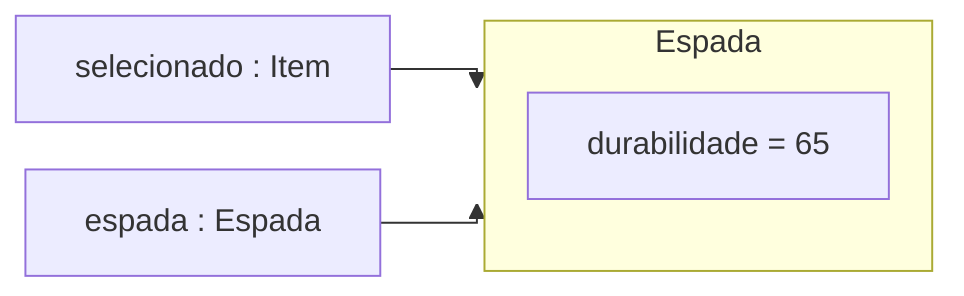

# Aula 17 — Inventário de jogo: interfaces e capacidades

Nas últimas aulas, contratos permitiram trocar colaboradores e combinar seus
comportamentos. Agora vamos usar esse repertório em um inventário de jogo:
todos os itens podem ser guardados e apresentados, mas apenas alguns aceitam
reparo. A seleção de um item vai nos obrigar a distinguir o que o objeto
oferece daquilo que uma referência permite solicitar.

!!! lesson-question "Pergunta central"

    Como um inventário guarda itens diferentes e permite operações específicas
    sem exigir que todos os itens ofereçam as mesmas capacidades?

!!! lesson-objectives "Objetivos"

    - Separar contratos conforme as responsabilidades de cada colaboração.
    - Distinguir compilação, compatibilidade de referências e despacho dinâmico.
    - Usar cast e `instanceof` preservando a identidade dos objetos.
    - Verificar delegação, consumo de recursos, limites e impacto de mudanças.

## De volta da exploração

Imagine um jogador que volta de uma exploração com três itens: uma espada de
ferro danificada, um escudo danificado e uma maçã. O **inventário** guarda esses
itens e permite selecionar um deles. A **bigorna** permite tentar reparar o
item selecionado usando uma pilha de material.

Você não precisa conhecer Minecraft. A inspiração é o reparo com materiais,
descrito nas referências oficiais de [bigorna](https://www.minecraft.net/en-us/article/taking-inventory--anvil)
e [escudo](https://www.minecraft.net/pl-pl/article/taking-inventory--shield).
Os números, a arquitetura e a atualização do mesmo objeto são simplificações
deste modelo didático.

| Item | Estado inicial | Material aceito | Efeito de uma unidade |
| --- | --- | --- | --- |
| Espada de ferro | durabilidade `40/100` | `"ferro"` | acrescenta `25`, até `100` |
| Escudo | durabilidade `30/80` | `"madeira"` | acrescenta `20`, até `80` |
| Maçã | sem durabilidade | não aceita reparo | operação indisponível |

Um reparo bem-sucedido devolve `true` e consome **uma unidade** de material.
Mesmo que faltem apenas `10` pontos para completar a espada, uma unidade é
consumida e a durabilidade para em `100`.

Material incompatível, pilha vazia ou equipamento já completo fazem a operação
devolver `false`, sem alterar durabilidade nem quantidade. Tentar reparar a
maçã também deve devolver `false` sem consumir material.

Neste recorte, os itens do inventário são diferentes de `null`, os índices
usados são válidos e as pilhas oferecidas são diferentes de `null`. Obter um
item devolve uma referência: não o remove nem cria uma cópia.

## Um contrato basta para listar

Para apresentar os três itens, basta uma operação comum. Em `Item.java`:

```java
public interface Item {
    String descrever();
}
```

Na versão inicial, `Espada`, `Escudo` e `Maca` cumprem `Item`. Cada equipamento
recebe sua durabilidade no construtor. Suas descrições são, respectivamente,
`"Espada de ferro: 40/100"`, `"Escudo: 30/80"` e `"Maçã"` no estado inicial.
A maçã não precisa de campos para esta investigação:

```java
public class Maca implements Item {
    public String descrever() {
        return "Maçã";
    }
}
```

`Inventario` guarda uma `List<Item>` privada. `adicionar(...)` guarda a
referência recebida, `obter(indice)` consulta uma posição e `listar()` usa:

```java
for (Item item : itens) {
    System.out.println(item.descrever());
}
```

??? "Código de apoio — Inventario.java"

    ```java
    import java.util.ArrayList;
    import java.util.List;

    public class Inventario {
        private List<Item> itens;

        public Inventario() {
            itens = new ArrayList<>();
        }

        public void adicionar(Item item) {
            itens.add(item);
        }

        public Item obter(int indice) {
            return itens.get(indice);
        }

        public void listar() {
            for (Item item : itens) {
                System.out.println(item.descrever());
            }
        }
    }
    ```

Monte este **cenário-base**, que também prepara o material do primeiro reparo:

```java
Inventario inventario = new Inventario();
inventario.adicionar(new Espada(40)); // posição 0
inventario.adicionar(new Escudo(30)); // posição 1
inventario.adicionar(new Maca());     // posição 2
PilhaMaterial ferro = new PilhaMaterial("ferro", 2);

inventario.listar();
```

1. Quais linhas `listar()` imprime, na ordem?
2. Qual é o tipo declarado de `item` no laço? Como a implementação de
   `descrever()` é escolhida em cada passagem?
3. Precisamos descobrir a classe de cada item para solicitar sua descrição?

??? "Ver resposta"

    1. A saída é:

        ```text
        Espada de ferro: 40/100
        Escudo: 30/80
        Maçã
        ```

    2. O tipo declarado é `Item`. Cada objeto alcançado determina qual
       implementação de `descrever()` executa: espada, escudo e maçã.
    3. Não. A chamada já pertence ao contrato `Item`; o despacho dinâmico
       seleciona a implementação durante a execução.

A listagem está resolvida. A dificuldade aparece quando o jogador seleciona
um item para uma operação que nem todos oferecem.

## O item selecionado é uma espada; a referência é Item

Inicialmente, `Espada` e `Escudo` já possuem o método público
`boolean repararCom(PilhaMaterial material)` e a consulta
`int getDurabilidade()`, mas implementam apenas `Item`.
A pilha oferece três operações:

| Operação | Responsabilidade |
| --- | --- |
| `ehDoTipo(String tipoEsperado)` | consultar se o material é o solicitado |
| `consumirUma()` | retirar uma unidade e devolver `true` se houver saldo; caso contrário, devolver `false` sem alterar a quantidade |
| `getQuantidade()` | consultar o saldo |

??? "Código de apoio — PilhaMaterial.java"

    ```java
    public class PilhaMaterial {
        private String tipo;
        private int quantidade;

        public PilhaMaterial(String tipo, int quantidade) {
            this.tipo = tipo;
            if (quantidade >= 0) {
                this.quantidade = quantidade;
            }
        }

        public boolean ehDoTipo(String tipoEsperado) {
            return tipo.equals(tipoEsperado);
        }

        public boolean consumirUma() {
            if (quantidade > 0) {
                quantidade--;
                return true;
            }
            return false;
        }

        public int getQuantidade() {
            return quantidade;
        }
    }
    ```

    Os tipos de material são textos diferentes de `null`. A chamada
    `tipo.equals(tipoEsperado)` compara o conteúdo desses textos. O `==`
    usado para investigar identidade de objetos não substitui essa comparação.

Na espada, o método de reparo usa o campo privado `durabilidade` desta forma:

```java
public boolean repararCom(PilhaMaterial material) {
    if (!material.ehDoTipo("ferro") || durabilidade == 100) {
        return false;
    }
    if (!material.consumirUma()) {
        return false;
    }
    durabilidade += 25;
    if (durabilidade > 100) {
        durabilidade = 100;
    }
    return true;
}
```

O equipamento protege seu limite e a compatibilidade; a pilha protege seu
saldo. Só há aumento de durabilidade depois de um consumo bem-sucedido.

No **cenário-base ainda sem reparos**, analise esta tentativa. É um trecho para
diagnosticar compilação, separado dos exemplos executáveis:

```java
Item selecionado = inventario.obter(0);
selecionado.repararCom(ferro); // não compila
```

Por que o compilador recusa a chamada, mesmo quando a posição `0` contém uma
espada que possui esse método público?

??? "Ver resposta"

    O tipo declarado de `selecionado` é `Item`, cujo contrato só declara
    `descrever()`. O compilador verifica a chamada por esse tipo. O despacho
    dinâmico não acrescenta operações ao contrato durante a compilação.

Sabendo que essa seleção alcança uma espada, podemos usar a referência por
outro tipo. Substitua a tentativa anterior por:

```java
Item selecionado = inventario.obter(0);
Espada espada = (Espada) selecionado;
boolean reparou = espada.repararCom(ferro);

System.out.println(reparou);
System.out.println(espada.getDurabilidade());
System.out.println(ferro.getQuantidade());
System.out.println(selecionado == espada);
inventario.listar();
```

!!! activity "Atividade — outro acesso, o mesmo objeto"

    A espada começa em `40/100` e a pilha contém `2` unidades de ferro.

    1. Preveja as sete linhas impressas.
    2. Quantas espadas existem depois do cast? Qual é a classe do objeto e
       quais são os tipos declarados das duas variáveis locais?
    3. Depois desse código, `selecionado.repararCom(ferro)` passa a compilar?

??? "Ver resposta"

    1. A saída é:

        ```text
        true
        65
        1
        true
        Espada de ferro: 65/100
        Escudo: 30/80
        Maçã
        ```

    2. Uma única espada, da classe `Espada`. `selecionado` tem tipo declarado
       `Item`; `espada` tem tipo declarado `Espada`. As duas referências e a
       posição `0` do inventário alcançam o mesmo objeto.
    3. Não. A declaração de `selecionado` continua sendo `Item`.

!!! java-focus "Java em foco — cast de uma referência"

    Em `(Espada) selecionado`, os parênteses indicam uma **conversão explícita**,
    chamada de *cast*. A expressão permite usar a referência como `Espada`,
    desde que o objeto alcançado seja compatível com esse tipo.

    O cast não executa `new`, não copia o objeto e não muda sua classe nem
    seu estado. O reparo é que altera o estado, pela chamada ao método.

Depois do reparo, as duas referências locais podem ser representadas assim:



O diagrama omite o inventário para destacar as variáveis locais; ele continua
guardando a referência para essa mesma espada. Por isso sua listagem também
mostra a durabilidade atualizada.

## A conversão escrita pode falhar na execução

Considere agora um **cenário independente**, com o inventário novamente no
estado inicial e uma pilha nova de ferro com `2` unidades. A posição `2`
contém a maçã:

```java
Item selecionado = inventario.obter(2);
Espada espada = (Espada) selecionado;
espada.repararCom(ferro);
System.out.println("Terminou");
```

O trecho compila? O que acontece quando ele é executado? A mensagem é impressa
ou algum material é consumido?

??? "Ver resposta"

    - Compila: uma referência declarada `Item` pode alcançar uma espada.
      O compilador aceita essa possibilidade de conversão.
    - Neste cenário, o objeto real é uma `Maca`. A conversão falha na execução
      com `ClassCastException`; a maçã não se transforma em espada.
    - Nesse programa, sem tratamento da falha, as linhas seguintes não são
      executadas. Não há reparo, consumo nem impressão de `"Terminou"`.

Precisamos verificar a compatibilidade **antes** da conversão. Reinicie o mesmo
cenário e substitua a tentativa por:

```java
Item selecionado = inventario.obter(2);
if (selecionado instanceof Espada) {
    Espada espada = (Espada) selecionado;
    espada.repararCom(ferro);
}
```

`instanceof` produz um `boolean`: verifica se a referência alcança um objeto
compatível com o tipo indicado. O ramo acima só executa quando essa condição
é verdadeira. Para `null`, o resultado de `instanceof` é `false`.

Em quatro execuções independentes, use como `selecionado`: espada `40/100`,
escudo `30/80`, maçã e `null`. Cada execução recebe ferro novo com `2`
unidades. Em quais casos o ramo executa e qual é o estado final?

??? "Ver resposta"

    | Seleção | `instanceof Espada` | Efeito |
    | --- | --- | --- |
    | Espada | `true` | repara até `65/100`; ferro fica com `1` |
    | Escudo | `false` | permanece `30/80`; ferro fica com `2` |
    | Maçã | `false` | item preservado; ferro fica com `2` |
    | `null` | `false` | ramo ignorado; ferro fica com `2` |

O teste evita aquela conversão incompatível. Entretanto, ele ainda responde
uma pergunta estreita: “é uma espada?”. O escudo também precisa de reparo.

## A bigorna precisa de uma capacidade

Uma proposta usa um ramo para `Espada` e outro para `Escudo`. Uma terceira
classe reparável exigiria mais um ramo, embora o trabalho solicitado fosse
sempre o mesmo: tentar reparar usando o material oferecido.

Compare três alternativas para essa colaboração:

| Proposta | Decisão |
| --- | --- |
| A | Acrescentar `repararCom(...)` a todo `Item`, inclusive à maçã |
| B | Manter um ramo para cada classe concreta na bigorna |
| C | Manter `Item` para apresentação e criar outro contrato para quem aceita reparo |

Qual alternativa expressa a capacidade de reparo sem exigi-la da maçã e sem
listar todas as classes de equipamento na bigorna? Justifique pelos papéis
do inventário e da operação de reparo.

??? "Ver uma análise possível"

    - A proposta C separa os papéis: o inventário apresenta qualquer `Item`;
      a bigorna precisa da capacidade adicional de reparo.
    - A proposta A obriga a maçã a oferecer uma operação que não faz parte
      de seu papel neste modelo, mesmo que a implementação sempre recuse.
    - A proposta B reconhece os equipamentos atuais, mas vincula a bigorna
      aos nomes de todas as classes que oferecem a capacidade.

Em `Reparavel.java`, a capacidade fica explícita:

```java
public interface Reparavel {
    boolean repararCom(PilhaMaterial material);
    int getDurabilidade();
}
```

O método de reparo e a consulta de durabilidade já existem nos equipamentos.
Agora declaramos que `Espada` e `Escudo` cumprem **os dois contratos**. Suas
declarações passam a ser `public class Espada implements Item, Reparavel` e
`public class Escudo implements Item, Reparavel`. `Maca` continua somente com
`implements Item`.

!!! java-focus "Java em foco — duas interfaces no mesmo objeto"

    `implements Item, Reparavel` lista interfaces separadas por vírgula.
    A classe deve implementar as operações de ambas com métodos públicos.

    As interfaces são independentes. Uma referência `Reparavel` permite
    solicitar `repararCom(...)` e `getDurabilidade()`, mas não `descrever()`.
    O objeto também cumprir `Item` não acrescenta esse método a `Reparavel`.

A bigorna pode verificar a capacidade, converter e delegar. Em `Bigorna.java`:

```java
public class Bigorna {
    public boolean tentarReparar(Item item, PilhaMaterial material) {
        if (item instanceof Reparavel) {
            Reparavel equipamento = (Reparavel) item;
            return equipamento.repararCom(material);
        }
        return false;
    }
}
```

O teste de capacidade permite entrar no ramo. O cast permite usar a referência
como `Reparavel`. A chamada seguinte usa despacho dinâmico para executar o
método do equipamento real. A bigorna devolve o resultado dessa delegação.

Se uma operação já recebe `Reparavel equipamento`, pode solicitar o reparo
diretamente, considerando uma referência diferente de `null`. Não precisa
descobrir se a classe é `Espada` ou `Escudo`.

### Oferecer reparo garante que ele acontecerá?

Considere três cenários **independentes**, todos com a versão que usa
`Reparavel`. Em cada um, uma bigorna nova recebe o item e a pilha indicados:

| Cenário | Item | Pilha oferecida |
| --- | --- | --- |
| 1 | espada `100/100` | ferro, `2` unidades |
| 2 | espada `40/100` | madeira, `2` unidades |
| 3 | maçã | ferro, `2` unidades |

Para cada cenário, preveja `item instanceof Reparavel`, o retorno de
`tentarReparar(...)`, o saldo da pilha e o estado do item. Em quais casos o
método de reparo do equipamento chega a executar?

??? "Ver resposta"

    | Cenário | Capacidade | Retorno | Estado final |
    | --- | --- | --- | --- |
    | 1 | `true` | `false` | espada `100/100`; ferro `2` |
    | 2 | `true` | `false` | espada `40/100`; madeira `2` |
    | 3 | `false` | `false` | maçã preservada; ferro `2` |

    Nos cenários 1 e 2, o cast é válido e `Espada.repararCom(...)` executa,
    recusando a operação por estado ou material. No cenário 3, o ramo de
    reparo da bigorna não executa. Receber `null` como item também faria a
    bigorna devolver `false` sem entrar nesse ramo.

Ter a capacidade permite solicitar a operação. As condições do objeto e do
material determinam se ela terá sucesso. Na Aula 15, fornecer uma entrega de
tipo aceito também não garantia que um pedido já fechado fosse fechado outra vez.

### Quem altera cada estado?

Em um **novo cenário**, um escudo começa em `30/80` e uma pilha contém `2`
unidades de madeira:

```java
Item item = new Escudo(30);
PilhaMaterial madeira = new PilhaMaterial("madeira", 2);
Bigorna bigorna = new Bigorna();
boolean reparou = bigorna.tentarReparar(item, madeira);
```

Reconstrua o caminho da chamada. Qual implementação de `repararCom(...)`
executa, qual objeto altera a quantidade e qual altera a durabilidade?
Indique também o retorno e o estado final.

??? "Ver resposta"

    1. A bigorna reconhece `Reparavel` e delega ao mesmo objeto `Escudo`.
    2. `Escudo.repararCom(...)` confere madeira e durabilidade; solicita
       `consumirUma()` à pilha recebida.
    3. A pilha reduz seu próprio saldo para `1` e devolve `true`.
    4. O escudo aumenta sua durabilidade para `50/80` e devolve `true`.
       A bigorna devolve esse mesmo resultado.

Cada objeto protege seu estado. A bigorna não contém os valores `25` e `20`,
não muda campos privados dos equipamentos e não cria outro item para reparar.
Ela coordena o acesso à capacidade do objeto recebido.

## Verificar o resultado inclui verificar o consumo

Retorno, durabilidade e quantidade respondem perguntas diferentes. Antes de
ler os testes, preveja os três resultados de cada linha abaixo. Os cenários
são independentes, sempre com uma espada nova e ferro ou madeira novos:

| Cenário | Estado inicial | Material |
| --- | --- | --- |
| Reparo possível | espada `40/100` | ferro, `2` unidades |
| Material incompatível | espada `40/100` | madeira, `2` unidades |
| Próximo ao máximo | espada `90/100` | ferro, `2` unidades |

??? "Ver resposta"

    | Cenário | Retorno | Durabilidade final | Material restante |
    | --- | --- | --- | --- |
    | Reparo possível | `true` | `65` | `1` |
    | Material incompatível | `false` | `40` | `2` |
    | Próximo ao máximo | `true` | `100` | `1` |

    No último caso, a unidade é consumida por inteiro. O limite impede que a
    durabilidade chegue a `115`.

Com o JUnit Jupiter já configurado, essas expectativas podem ser executadas.
Em `BigornaTest.java`:

```java
import org.junit.jupiter.api.Test;
import static org.junit.jupiter.api.Assertions.assertEquals;

class BigornaTest {
    @Test
    void reparaOMesmoItemDoInventario() {
        Espada espada = new Espada(40);
        Inventario inventario = new Inventario();
        inventario.adicionar(espada);
        PilhaMaterial ferro = new PilhaMaterial("ferro", 2);
        Bigorna bigorna = new Bigorna();

        boolean reparou = bigorna.tentarReparar(inventario.obter(0), ferro);

        assertEquals(true, reparou);
        assertEquals(65, espada.getDurabilidade());
        assertEquals(1, ferro.getQuantidade());
        assertEquals(true, inventario.obter(0) == espada);
    }

    @Test
    void materialIncompativelPreservaItemEPilha() {
        Espada espada = new Espada(40);
        PilhaMaterial madeira = new PilhaMaterial("madeira", 2);
        Bigorna bigorna = new Bigorna();

        boolean reparou = bigorna.tentarReparar(espada, madeira);

        assertEquals(false, reparou);
        assertEquals(40, espada.getDurabilidade());
        assertEquals(2, madeira.getQuantidade());
    }

    @Test
    void limitaDurabilidadeMesmoConsumindoUmaUnidade() {
        Espada espada = new Espada(90);
        PilhaMaterial ferro = new PilhaMaterial("ferro", 2);
        Bigorna bigorna = new Bigorna();

        boolean reparou = bigorna.tentarReparar(espada, ferro);

        assertEquals(true, reparou);
        assertEquals(100, espada.getDurabilidade());
        assertEquals(1, ferro.getQuantidade());
    }
}
```

Uma solução que reparasse indevidamente a maçã seria descoberta por esses
três testes? E uma que reparasse a espada corretamente, mas nunca consumisse
material? Justifique pelas observações feitas em cada teste.

??? "Ver resposta"

    - O reparo indevido da maçã não seria descoberto: nenhum dos três testes
      fornece uma maçã à bigorna. Eles também não verificam a regra do escudo.
    - A ausência de consumo seria descoberta no primeiro e no terceiro teste:
      ambos esperam saldo `1`, além do retorno e da durabilidade.

??? "Casos complementares para consulta"

    Em cada linha, use uma bigorna e objetos novos:

    | Item e material iniciais | Retorno | Estado final |
    | --- | --- | --- |
    | Escudo `30/80`; madeira `2` | `true` | escudo `50/80`; madeira `1` |
    | Espada `100/100`; ferro `2` | `false` | espada `100/100`; ferro `2` |
    | Espada `40/100`; ferro `0` | `false` | espada `40/100`; ferro `0` |
    | Maçã; ferro `2` | `false` | maçã preservada; ferro `2` |

## Um equipamento novo muda quais pontos?

O jogo passa a oferecer uma `Picareta`. Neste modelo, ela é um `Item` e aceita
reparo com ferro: acrescenta `25` até o máximo didático de `100`, consumindo
uma unidade por sucesso e preservando os estados em caso de recusa.

Indique os contratos e métodos que a nova classe deve oferecer. Depois,
identifique onde ela é criada e adicionada. O laço de listagem e o método
`Bigorna.tentarReparar(...)` precisam de novos ramos? Que teste acrescentaria
para verificar a regra da nova classe?

??? "Ver uma análise possível"

    - `Picareta` declara `implements Item, Reparavel` e oferece `descrever()`,
      `repararCom(PilhaMaterial material)` e `getDurabilidade()`.
    - A criação fica no código de montagem: por exemplo,
      `inventario.adicionar(new Picareta(40))`.
    - O laço continua solicitando `descrever()`. A bigorna continua verificando
      `Reparavel` e delegando. Nenhum dos dois precisa nomear `Picareta`.
    - Um teste inicial fornece a picareta `40/100` e ferro com `2` unidades:
      espera `true`, durabilidade `65` e ferro `1`. Casos de recusa e limite
      complementam a verificação da nova implementação.

O contrato preserva os pontos de colaboração. Criar a classe e escolher onde
instanciá-la continuam sendo mudanças necessárias, assim como verificar sua regra.

## Aplicação individual

Tente responder sem consulta e antes de abrir cada resposta. Esta atividade
é formativa, sem nota ou entrega. Se usar IA no estudo, mantenha o **Nível 1 —
Tutor**: produza primeiro suas previsões e justificativas; depois peça ajuda
para compreender uma dúvida, sem delegar as respostas.

### 1. Não compila ou falha ao executar?

Analise as alternativas **separadamente**, usando as classes finais da aula:

```java
// Alternativa A
Item item = new Espada(40);
item.repararCom(new PilhaMaterial("ferro", 2));
```

```java
// Alternativa B
Item item = new Maca();
Espada espada = (Espada) item;
```

Qual alternativa é recusada na compilação e qual compila, mas falha na
execução? Justifique sem confundir o tipo declarado com o objeto real.

??? "Ver resposta"

    - A é recusada: `Item` não declara `repararCom(...)`.
    - B compila porque a referência declarada `Item` admite a possibilidade
      de alcançar uma espada. Na execução, o objeto é uma `Maca`, e o cast
      falha com `ClassCastException`.

### 2. O inventário observa qual estado?

Em um **novo cenário**, execute:

```java
Inventario inventario = new Inventario();
inventario.adicionar(new Espada(90));
Item selecionado = inventario.obter(0);
Reparavel equipamento = (Reparavel) selecionado;
PilhaMaterial ferro = new PilhaMaterial("ferro", 2);

equipamento.repararCom(ferro);
System.out.println(inventario.obter(0).descrever());
System.out.println(ferro.getQuantidade());
```

Preveja as duas linhas e explique por que a atualização aparece ao consultar
o inventário. O cast criou outro equipamento?

??? "Ver resposta"

    - Imprime `Espada de ferro: 100/100` e depois `1`.
    - O cast preserva a referência para a mesma espada. A posição do inventário,
      `selecionado` e `equipamento` alcançam esse objeto; o reparo altera sua
      durabilidade e consome uma unidade da pilha recebida.

### 3. O contrato escolhe a regra?

Em outro cenário, `Item item = new Escudo(30)` e
`PilhaMaterial madeira = new PilhaMaterial("madeira", 2)` são fornecidos à
bigorna.

1. Por que o cast para `Reparavel` dentro da bigorna é válido?
2. Qual implementação de `repararCom(...)` executa?
3. Qual é o retorno da tentativa, a durabilidade final do escudo e o saldo
   da pilha de madeira?
4. Uma referência declarada `Reparavel` também permite chamar `descrever()`
   diretamente? Justifique.

??? "Ver resposta"

    1. O objeto `Escudo` cumpre `Reparavel`, condição verificada pelo `instanceof`.
    2. Executa `Escudo.repararCom(...)` por despacho dinâmico.
    3. O retorno é `true`, o escudo termina em `50/80` e a madeira em `1` unidade.
    4. Não. `descrever()` pertence a `Item`, não ao contrato `Reparavel`.

### 4. Que cenário revela o defeito?

Duas versões defeituosas são propostas **separadamente**:

- A bigorna cria uma `Espada(40)` e repara essa nova espada em vez de usar o
  item recebido.
- O equipamento consome uma unidade antes de verificar se o material é
  compatível; se não for, devolve `false` sem aumentar a durabilidade.

Escolha um cenário que revele cada defeito. Informe o estado inicial, a ação
e as observações esperadas na solução correta, incluindo o saldo do material.

??? "Ver uma análise possível"

    1. Forneça uma espada original `40/100` e ferro `2` à primeira versão.
       Após a tentativa correta, o retorno é `true`, **a espada fornecida**
       está em `65/100` e o ferro em `1`. Reparar uma nova espada deixa a
       original em `40/100`, revelando que o colaborador foi ignorado.
    2. Forneça outra espada `40/100` e madeira `2` à segunda versão. A tentativa
       correta devolve `false`, conserva a espada em `40/100` e a madeira em
       `2`. O consumo antecipado deixa madeira `1`, mesmo com retorno e
       durabilidade aparentemente corretos.

!!! synthesis "Síntese"

    - O tipo declarado determina as operações permitidas na compilação.
    - O cast permite outro uso compatível da referência, preservando o objeto.
    - `instanceof` verifica compatibilidade antes da conversão; o despacho
      dinâmico escolhe a implementação da chamada aceita.
    - Contratos distintos expressam capacidades distintas do mesmo objeto.
    - Delegação e testes devem preservar o colaborador recebido e observar
      tanto o resultado quanto os estados envolvidos.

## Código completo dos equipamentos para consulta

Os trechos anteriores mostram a investigação progressiva. Abaixo estão as
versões finais dos dois equipamentos, já com `Item` e `Reparavel`. Junte-as
aos arquivos de apoio e aos contratos apresentados. Não é necessário
reconstruir essas classes para responder às atividades.

??? "Espada.java"

    ```java
    public class Espada implements Item, Reparavel {
        private int durabilidade;

        public Espada(int durabilidade) {
            if (durabilidade >= 0 && durabilidade <= 100) {
                this.durabilidade = durabilidade;
            }
        }

        public String descrever() {
            return "Espada de ferro: " + durabilidade + "/100";
        }

        public int getDurabilidade() {
            return durabilidade;
        }

        public boolean repararCom(PilhaMaterial material) {
            if (!material.ehDoTipo("ferro") || durabilidade == 100) {
                return false;
            }
            if (!material.consumirUma()) {
                return false;
            }
            durabilidade += 25;
            if (durabilidade > 100) {
                durabilidade = 100;
            }
            return true;
        }
    }
    ```

??? "Escudo.java"

    ```java
    public class Escudo implements Item, Reparavel {
        private int durabilidade;

        public Escudo(int durabilidade) {
            if (durabilidade >= 0 && durabilidade <= 80) {
                this.durabilidade = durabilidade;
            }
        }

        public String descrever() {
            return "Escudo: " + durabilidade + "/80";
        }

        public int getDurabilidade() {
            return durabilidade;
        }

        public boolean repararCom(PilhaMaterial material) {
            if (!material.ehDoTipo("madeira") || durabilidade == 80) {
                return false;
            }
            if (!material.consumirUma()) {
                return false;
            }
            durabilidade += 20;
            if (durabilidade > 80) {
                durabilidade = 80;
            }
            return true;
        }
    }
    ```

Os construtores usam condicionais conhecidas para preservar os intervalos;
fora deles, a durabilidade ou quantidade permanece no padrão `0`. Todos os
cenários da aula fornecem valores iniciais válidos.

??? "Main.java — executar a solução final"

    Coloque cada classe e interface pública em seu arquivo de mesmo nome.
    O `Main` abaixo usa os oito tipos apresentados e não precisa de JUnit:

    ```java
    public class Main {
        public static void main(String[] args) {
            Inventario inventario = new Inventario();
            inventario.adicionar(new Espada(40));
            inventario.adicionar(new Escudo(30));
            inventario.adicionar(new Maca());
            PilhaMaterial ferro = new PilhaMaterial("ferro", 2);
            Bigorna bigorna = new Bigorna();

            System.out.println(bigorna.tentarReparar(inventario.obter(0), ferro));
            inventario.listar();
            System.out.println(ferro.getQuantidade());
        }
    }
    ```

    Ao executar, a saída esperada é:

    ```text
    true
    Espada de ferro: 65/100
    Escudo: 30/80
    Maçã
    1
    ```

    `BigornaTest.java` fica na área de testes de um projeto com JUnit Jupiter
    configurado, conforme a [Aula 13](aula-13-como-saber-se-ainda-funciona.md).

### Aprofundamento opcional — reatribuir depois da seleção

Em um inventário novo, guarde uma `Espada(40)` na posição `0`. Execute:

```java
Item selecionado = inventario.obter(0);
selecionado = new Escudo(30);
PilhaMaterial madeira = new PilhaMaterial("madeira", 2);
new Bigorna().tentarReparar(selecionado, madeira);
inventario.listar();
System.out.println(selecionado.descrever());
```

Quais são as duas linhas impressas? O escudo substituiu a espada na lista?

??? "Ver resposta"

    - Imprime `Espada de ferro: 40/100` e depois `Escudo: 50/80`.
    - A reatribuição altera a variável local. O inventário continua guardando
      a referência para a espada; o reparo alcança o escudo recém-criado.

## Materiais relacionados

- [Aula 14 — Do colaborador concreto ao contrato](aula-14-do-colaborador-concreto-ao-contrato.md)
- [Aula 15 — Polimorfismo: a mesma mensagem, comportamentos diferentes](aula-15-polimorfismo-a-mesma-mensagem-comportamentos-diferentes.md)
- [Aula 16 — Combinando comportamentos por composição](aula-16-combinando-comportamentos-por-composicao.md)
- [Aula 13 — Como saber se ainda funciona?](aula-13-como-saber-se-ainda-funciona.md)
- [Java essencial para quem já sabe programar](../materiais/java-essencial.md)
- [Especificação Java — conversões por cast](https://docs.oracle.com/javase/specs/jls/se25/html/jls-5.html#jls-5.5)
- [Especificação Java — operador instanceof](https://docs.oracle.com/javase/specs/jls/se25/html/jls-15.html#jls-15.20.2)
