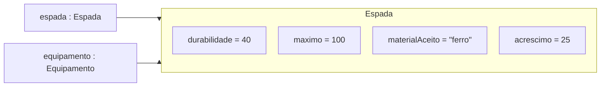

# Aula 18 — Compartilhando regras sem perder os contratos

Na Aula 17, espada e escudo aceitaram reparos por meio de `Reparavel`. A bigorna
conseguiu trabalhar com os dois sem conhecer suas classes. Dentro dos
equipamentos, porém, ficou uma repetição: ambos protegem a durabilidade,
verificam o material, solicitam o consumo e respeitam um limite.

Vamos investigar como compartilhar essas regras, preservando os contratos que
já permitem a colaboração entre os objetos.

**Slides:** [Apresentação HTML](../slides/rendered/aula-18-compartilhando-regras-sem-perder-os-contratos.html) · [PDF](../slides/rendered/aula-18-compartilhando-regras-sem-perder-os-contratos.pdf)

!!! lesson-question "Pergunta central"

    Quando classes diferentes podem compartilhar implementação sem perder
    suas responsabilidades?

!!! lesson-objectives "Objetivos"

    - Identificar regras comuns que justificam uma relação de herança.
    - Explicar a construção, o estado e os métodos de um objeto de subclasse.
    - Prever chamadas a métodos herdados e sobrescritos por referências de tipos diferentes.
    - Comparar interface, classe abstrata e composição, justificando escolhas de projeto.

!!! info "Uso de IA — Nível 1: Tutor"

    Faça as previsões e formule suas justificativas antes de consultar ajuda.
    A IA pode esclarecer conceitos, código e mensagens de compilação.

<!-- Dimensionamento docente: núcleo de 90 minutos conforme o planejamento
aprovado em specs/planejamento-fechamento-unidade-02.md. Recuperação e repetição:
10 min; extração e construção: 25 min; abstração, sobrescrita e chamadas: 20 min;
comparação de alternativas e ponte para o laboratório: 20 min; verificação e
fechamento: 15 min. O aprofundamento final é elástico. O Laboratório 18 continua
o Projeto 2 com estado e contagem de envios por notificador, conforme decisão
posterior do professor.
Roteiro revisado; ajuste pontual e derivação dos slides solicitados pelo professor. -->

## O reparo funciona, mas a regra está em dois lugares

O jogador continua selecionando itens do inventário e tentando repará-los na
bigorna. O recorte é o mesmo da aula anterior:

| Item | Durabilidade inicial | Material aceito | Reparo com uma unidade |
| --- | --- | --- | --- |
| Espada de ferro | `40/100` | `"ferro"` | acrescenta `25`, até `100` |
| Escudo | `30/80` | `"madeira"` | acrescenta `20`, até `80` |
| Maçã | não possui | nenhum | não oferece reparo |

Um reparo bem-sucedido consome uma unidade inteira e devolve `true`, mesmo
quando falta menos que o acréscimo normal para atingir o máximo. Material
incompatível, pilha vazia ou equipamento completo produzem `false`, sem mudar
o equipamento nem o saldo. A bigorna também devolve `false` para um item sem
a capacidade de reparo.

Nesta aula, as referências recebidas pelos equipamentos são diferentes de
`null` e os construtores recebem valores válidos: durabilidade entre zero e
o máximo, máximo e acréscimo positivos, material não nulo nem vazio. As pilhas
têm quantidades não negativas. O tratamento de entradas inválidas será
investigado no próximo encontro.

Os contratos continuam independentes. Cada tipo público fica em seu próprio
arquivo `.java`, com o mesmo nome do tipo:

```java
public interface Item {
    String descrever();
}
```

```java
public interface Reparavel {
    boolean repararCom(PilhaMaterial material);
    int getDurabilidade();
}
```

`PilhaMaterial` guarda o tipo e a quantidade. `ehDoTipo(...)` compara o material;
`consumirUma()` retira uma unidade e devolve `true` somente se houver saldo;
`getQuantidade()` consulta esse saldo. Seu código, assim como `Inventario`,
`Maca` e `Bigorna`, está disponível na
[Aula 17](aula-17-inventario-de-jogo-interfaces-e-capacidades.md).

Em um **cenário independente**, considere a versão da Aula 17:

```java
Escudo escudo = new Escudo(30);
Reparavel equipamento = escudo;
PilhaMaterial madeira = new PilhaMaterial("madeira", 2);

boolean reparou = equipamento.repararCom(madeira);
```

Qual é o retorno, qual é a durabilidade final e quanto material resta? Qual
objeto altera a durabilidade e qual altera o saldo?

??? "Ver resposta"

    - O retorno é `true`; o escudo passa a `50/80`; resta `1` unidade de madeira.
    - O escudo altera sua durabilidade. A pilha altera seu saldo quando recebe
      `consumirUma()`.
    - A variável `equipamento` alcança o mesmo escudo. Usar a interface não
      cria um segundo objeto.

O método da espada continha esta implementação, usando seu campo privado
`durabilidade`:

```java
public boolean repararCom(PilhaMaterial material) {
    if (!material.ehDoTipo("ferro") || durabilidade == 100) {
        return false;
    }
    if (!material.consumirUma()) {
        return false;
    }
    durabilidade += 25;
    if (durabilidade > 100) {
        durabilidade = 100;
    }
    return true;
}
```

No escudo, a sequência era:

```java
public boolean repararCom(PilhaMaterial material) {
    if (!material.ehDoTipo("madeira") || durabilidade == 80) {
        return false;
    }
    if (!material.consumirUma()) {
        return false;
    }
    durabilidade += 20;
    if (durabilidade > 80) {
        durabilidade = 80;
    }
    return true;
}
```

!!! activity "Atividade — o que varia e o que se repete?"

    1. Identifique três dados que diferem entre os métodos.
    2. Que sequência de decisões e alterações é comum aos dois?
    3. Se houvesse um defeito no controle do limite, em quantos lugares dessa
       versão precisaríamos conferir a correção?

??? "Ver resposta"

    1. O material aceito, o máximo de durabilidade e o acréscimo por reparo.
    2. Conferir material e estado; tentar consumir uma unidade; aumentar a
       durabilidade somente após o consumo; limitar o resultado; informar sucesso.
    3. Nos dois métodos. Corrigir somente a espada deixaria o escudo com a
       implementação anterior.

A semelhança vai além de campos com o mesmo nome: os dois equipamentos seguem
a mesma regra de reparo. Podemos representar os dados que variam e concentrar
essa regra em uma implementação comum.

## Uma base para os equipamentos reparáveis

Neste modelo, uma espada e um escudo são equipamentos reparáveis. Uma classe
`Equipamento` pode guardar a durabilidade e os parâmetros do reparo. As classes
`Espada` e `Escudo` passam a ser **subclasses** dessa **superclasse**.

Há, entretanto, uma operação que ainda depende do equipamento específico:
`descrever()`. A espada precisa se apresentar como espada; o escudo, como
escudo. Não temos uma descrição concreta para um equipamento genérico.

Por isso, a base será uma **classe abstrata**: concentra a implementação
comum, mas deixa a descrição a cargo das subclasses concretas. A declaração
`public abstract String descrever();` exige a operação sem fornecer seu corpo.
Ela termina em ponto e vírgula, sem chaves.

Em `Equipamento.java`:

```java
public abstract class Equipamento implements Item, Reparavel {
    private int durabilidade;
    private int maximo;
    private String materialAceito;
    private int acrescimo;

    protected Equipamento(int durabilidadeInicial, int maximo,
                          String materialAceito, int acrescimo) {
        this.durabilidade = durabilidadeInicial;
        this.maximo = maximo;
        this.materialAceito = materialAceito;
        this.acrescimo = acrescimo;
    }

    @Override
    public int getDurabilidade() {
        return durabilidade;
    }

    @Override
    public boolean repararCom(PilhaMaterial material) {
        if (!material.ehDoTipo(materialAceito) || durabilidade == maximo) {
            return false;
        }
        if (!material.consumirUma()) {
            return false;
        }
        durabilidade += acrescimo;
        if (durabilidade > maximo) {
            durabilidade = maximo;
        }
        return true;
    }

    @Override
    public abstract String descrever();
}
```

Os dois contratos continuam presentes em `implements Item, Reparavel`.
`getDurabilidade()` e `repararCom(...)` já têm implementação. A descrição será
implementada em cada subclasse. A anotação `@Override` sinaliza ao compilador
que a operação corresponde a uma declaração de um supertipo; aqui, às interfaces.

Em `Espada.java`, **substitua a classe anterior**, sem conservar uma segunda
cópia do campo de durabilidade ou do método de reparo:

```java
public class Espada extends Equipamento {
    public Espada(int durabilidadeInicial) {
        super(durabilidadeInicial, 100, "ferro", 25);
    }

    @Override
    public String descrever() {
        return "Espada de ferro: " + getDurabilidade() + "/100";
    }
}
```

Em `Escudo.java`, a substituição segue a mesma estrutura:

```java
public class Escudo extends Equipamento {
    public Escudo(int durabilidadeInicial) {
        super(durabilidadeInicial, 80, "madeira", 20);
    }

    @Override
    public String descrever() {
        return "Escudo: " + getDurabilidade() + "/80";
    }
}
```

!!! java-focus "Java em foco — estender uma classe"

    - `extends Equipamento` estabelece a relação de herança entre as classes.
    - As subclasses herdam os métodos públicos de reparo e de consulta. Também
      cumprem `Item` e `Reparavel`, sem repetir o `implements`.
    - `super(...)` chama o construtor da superclasse com os argumentos indicados.
    - O construtor `protected` da base permite essa chamada pelas subclasses.
      Isso não torna públicos os seus campos.

Em `super(durabilidadeInicial, 100, "ferro", 25)`, os argumentos significam,
nessa ordem: durabilidade inicial, máximo, material aceito e acréscimo por
unidade. São os mesmos dados que antes apareciam na implementação da espada.
A regra usa os campos de cada objeto, sem testar se ele é espada ou escudo.

!!! conceito-chave "Conceito-chave — herança de implementação"

    Uma subclasse pode usar métodos implementados na superclasse e fornecer
    suas próprias implementações para operações sobrescritas. Neste recorte,
    espada e escudo compartilham a regra de reparo e preservam descrições próprias.

## Dois construtores participam; uma espada é criada

Considere apenas esta criação, em um **novo cenário**:

```java
Espada espada = new Espada(40);
Equipamento equipamento = espada;
```

Os passos relevantes à inicialização são:

1. O construtor de `Espada` recebe `40` em `durabilidadeInicial`.
2. Ele solicita a inicialização definida por `Equipamento`, passando
   `40`, `100`, `"ferro"` e `25`.
3. O construtor de `Equipamento` atribui esses valores aos campos do objeto
   que está sendo construído.
4. A construção termina e a referência é atribuída a `espada`. A atribuição
   seguinte permite acessar esse mesmo objeto como `Equipamento`.

Não há `new Equipamento(...)` nessa sequência. A participação do construtor da
base não cria um colaborador separado. O objeto concreto é uma `Espada`.
Construtores não são herdados: `Espada` declara o seu e chama o da base.



O contêiner representa o único objeto; as setas representam referências a ele.
Os campos estão declarados na base, mas compõem o estado dessa espada.

### O estado continua protegido

Os campos `private` de `Equipamento` não podem ser acessados diretamente pelo
código de `Espada`. Em sua descrição, `getDurabilidade()` consulta o estado
por um método herdado; não lê o campo diretamente.

Compare duas propostas para usar **dentro de `Espada`**:

| Proposta | Trecho |
| --- | --- |
| A | `return "Espada de ferro: " + durabilidade + "/100";` |
| B | `return "Espada de ferro: " + getDurabilidade() + "/100";` |

Qual compila com a base apresentada? Seria necessário trocar o campo para
`protected` para construir a descrição?

??? "Ver resposta"

    - B compila. A tenta acessar diretamente um campo privado declarado em
      outra classe e não compila.
    - Não é necessário ampliar a visibilidade do campo. O método público
      herdado já oferece a consulta necessária.
    - O código de `Equipamento` continua responsável por alterar a durabilidade
      respeitando a regra de reparo.

## A base é abstrata; as referências continuam úteis

Ter implementação comum não exige permitir a criação de um equipamento
genérico. `abstract` impede a criação direta de uma instância dessa classe.
Uma classe abstrata pode ter campos, construtor e métodos com corpo, como
acabamos de usar. Também pode declarar métodos abstratos, mas isso não é uma
obrigação de toda classe abstrata.

`Espada` e `Escudo` são concretas porque fornecem a descrição que ficou
pendente. Se uma subclasse não fornecer todas as implementações abstratas
necessárias, ela também precisará ser abstrata.

Analise cada linha **separadamente**. As linhas são propostas para diagnóstico,
não um programa a executar em sequência:

```java
Equipamento a = new Espada(40);
Equipamento b = new Equipamento(40, 100, "ferro", 25);
Item c = new Escudo(30);
Reparavel d = new Espada(40);
```

Quais linhas compilam? Por que declarar uma referência `Equipamento` é
diferente de escrever `new Equipamento(...)`?

??? "Ver resposta"

    - As linhas de `a`, `c` e `d` compilam. Os objetos criados são de classes
      concretas compatíveis com os tipos declarados.
    - A linha de `b` não compila: tenta instanciar a classe abstrata.
    - A referência `a` usa `Equipamento` como tipo para acessar uma espada.
      Isso não exige criar um objeto cuja classe concreta seja `Equipamento`.

### O que foi herdado e o que foi sobrescrito

`Espada` não declara `repararCom(...)`: usa a implementação herdada de
`Equipamento`. Já `descrever()` recebe na subclasse uma implementação para a
operação declarada na base. Isso é **sobrescrita**. O mesmo ocorre com a
descrição do escudo.

`@Override` ajuda a verificar essa intenção. Se escrevermos `descrver()` por
engano com essa anotação, o compilador denuncia que não corresponde à operação
esperada. A anotação não escolhe a implementação na execução; o despacho
dinâmico continua dependendo do objeto que recebe a chamada.

Em um **cenário novo**, crie os objetos e acompanhe as chamadas:

```java
Espada espada = new Espada(40);
Item item = espada;
Equipamento equipamento = espada;
Reparavel capacidade = espada;
PilhaMaterial ferro = new PilhaMaterial("ferro", 2);

System.out.println(item.descrever());
System.out.println(capacidade.repararCom(ferro));
System.out.println(equipamento.descrever());
System.out.println(espada.getDurabilidade());
System.out.println(ferro.getQuantidade());
System.out.println(item == equipamento);
```

!!! activity "Atividade — quatro referências, quais implementações?"

    1. Preveja as seis linhas impressas.
    2. Onde está implementado o reparo executado? E a descrição?
    3. Quantos equipamentos foram criados? Por que a descrição posterior
       observa a durabilidade reparada?
    4. A chamada `capacidade.descrever()` compilaria? E
       `equipamento.descrever()`?

??? "Ver resposta"

    1. A saída é:

        ```text
        Espada de ferro: 40/100
        true
        Espada de ferro: 65/100
        65
        1
        true
        ```

    2. O reparo usa o corpo de `Equipamento.repararCom(...)`, herdado pela
       espada. A descrição usa `Espada.descrever()`. O objeto continua sendo
       uma espada quando executa o método herdado.
    3. Um equipamento. As quatro referências alcançam a mesma espada, cujo
       estado foi alterado pelo reparo.
    4. `capacidade.descrever()` não compila: `Reparavel` não declara essa
       operação. `equipamento.descrever()` compila: a classe abstrata declara
       a operação, e o objeto concreto fornece sua implementação.

Trocar o tipo declarado não transforma o objeto nem muda onde o método foi
escrito. Uma chamada permitida pode executar um método herdado ou uma
implementação sobrescrita, conforme a operação e o objeto.

## A bigorna continua dependendo da capacidade

Os equipamentos passaram a compartilhar implementação. A necessidade da
bigorna permanece a mesma: verificar se o item selecionado aceita reparo e
delegar a ele. Sua implementação da Aula 17 continua válida:

```java
public class Bigorna {
    public boolean tentarReparar(Item item, PilhaMaterial material) {
        if (item instanceof Reparavel) {
            Reparavel equipamento = (Reparavel) item;
            return equipamento.repararCom(material);
        }
        return false;
    }
}
```

Uma espada criada pela nova versão continua sendo `Item` e `Reparavel`.
`Inventario` também pode conservar sua `List<Item>` e solicitar `descrever()`
de cada elemento. `Maca` continua implementando somente `Item`.

Considere estas propostas de mudança:

| Proposta | Justificativa apresentada |
| --- | --- |
| A | Trocar o teste da bigorna para `instanceof Equipamento`, pois todos os reparáveis atuais estendem essa base |
| B | Fazer `Maca` estender `Equipamento`, para colocar todos os itens na mesma hierarquia |
| C | Manter a bigorna dependente de `Reparavel` e usar `Equipamento` apenas onde suas regras comuns fizerem sentido |

Qual proposta preserva melhor os papéis definidos? Um futuro item que cumpra
`Item` e `Reparavel`, sem estender `Equipamento`, poderia usar a bigorna atual?

??? "Ver uma análise possível"

    - C preserva a capacidade requerida pela bigorna e a separação entre itens
      reparáveis e itens sem reparo.
    - A funciona para os equipamentos atuais, mas passa a exigir sua família
      de implementação. Um item reparável de outra hierarquia seria recusado.
    - B atribui à maçã durabilidade, material e reparo que não pertencem a
      seu papel neste recorte.
    - Um futuro item que cumpra os dois contratos pode usar a bigorna atual,
      mesmo sem compartilhar a implementação de `Equipamento`.

Compartilhar implementação é uma decisão entre classes relacionadas.
Oferecer uma capacidade é uma decisão de contrato. A interface continua útil
mesmo depois de existir uma classe abstrata.

## Compartilhar regras ou combinar colaboradores?

Na [Aula 16](aula-16-combinando-comportamentos-por-composicao.md),
`EntregaComSeguro` guardava outra `Entrega`, solicitava seu custo e somava
`5.0`. Havia um objeto que acrescentava o seguro e outro que calculava o
custo-base. O colaborador recebido podia ser uma entrega normal ou expressa.

Aqui, `Espada extends Equipamento` não guarda uma referência para outro
equipamento. O método herdado opera sobre o estado da própria espada. Essa
diferença ajuda a avaliar as escolhas:

| Recurso usado | Papel neste percurso | Exemplo |
| --- | --- | --- |
| Interface | Definir a operação que um cliente precisa poder solicitar | `Reparavel` permite que a bigorna delegue o reparo |
| Classe abstrata | Compartilhar estado e implementação entre subclasses relacionadas, deixando operações pendentes | `Equipamento` centraliza reparo; as subclasses descrevem cada equipamento |
| Composição e delegação | Distribuir tarefas entre objetos que colaboram | A entrega com seguro consulta a entrega recebida; o equipamento solicita consumo à pilha |

Herança e composição coexistem no exemplo atual: a espada usa regras herdadas
e colabora com a pilha recebida. Não precisamos escolher um único mecanismo
para o sistema inteiro.

!!! activity "Atividade — decidir pelo requisito"

    Analise as duas necessidades de forma independente:

    1. Uma nova ferramenta segue a mesma sequência de reparo, mudando apenas
       máximo, material, acréscimo e descrição. Que solução já disponível pode
       compartilhar essa implementação? Que condição torna essa escolha adequada?
    2. O seguro deve continuar combinável com modalidades diferentes, escolhidas
       na criação do objeto com seguro. O que se perderia ao criar apenas
       `EntregaNormalComSeguro extends EntregaNormal` e
       `EntregaExpressaComSeguro extends EntregaExpressa`?

??? "Ver uma análise possível"

    1. Uma subclasse de `Equipamento` pode informar seus dados ao construtor
       da base e implementar a descrição. A escolha faz sentido se a ferramenta
       realmente respeitar as regras dessa base e puder ser usada como esse
       equipamento. Se precisar de outra regra, a semelhança de alguns campos
       não basta para justificar a herança.
    2. Cada modalidade passaria a exigir uma classe própria para o seguro,
       repetindo o acréscimo. A composição permite que o objeto com seguro
       receba modalidades diferentes pelo contrato `Entrega` e delegue o cálculo.

Em Java, uma classe estende uma única classe diretamente e pode cumprir várias
interfaces. Escolher uma superclasse vincula a subclasse àquela implementação.
Se outra família também oferecer reparo, ela pode cumprir `Reparavel` sem
passar a pertencer a esta hierarquia.

!!! trap "Armadilha — herdar apenas para aproveitar código"

    Encontrar código parecido é um indício para investigar, não uma justificativa
    suficiente. Antes de estabelecer a hierarquia, confira se as subclasses
    podem respeitar as operações e regras da base. Se precisarem negar essas
    regras, reavalie a relação e a distribuição das responsabilidades.

## A organização mudou; o comportamento precisa permanecer

A extração da regra comum foi uma **refatoração**: mudamos a organização para
reduzir a repetição, preservando o comportamento esperado. Os testes da Aula 17
continuam relevantes, pois usam as mesmas construções públicas e operações.

Antes de conferir a resposta, preveja retorno, durabilidade e saldo em cada
cenário **independente**, agora com as subclasses de `Equipamento`:

| Cenário | Estado inicial | Pilha |
| --- | --- | --- |
| A | espada `90/100` | ferro, `2` unidades |
| B | escudo `30/80` | ferro, `2` unidades |
| C | escudo `30/80` | madeira, `2` unidades |

??? "Ver resposta"

    | Cenário | Retorno | Durabilidade final | Saldo final |
    | --- | --- | --- | --- |
    | A | `true` | `100` | `1` |
    | B | `false` | `30` | `2` |
    | C | `true` | `50` | `1` |

    A base executa o mesmo algoritmo com os dados do equipamento. No cenário A,
    o limite impede `115`; no B, o material incompatível impede o consumo; no C,
    o escudo usa seu acréscimo de `20`.

Com JUnit Jupiter já configurado, o cenário A pode ser registrado em
`EquipamentoTest.java`:

```java
import org.junit.jupiter.api.Test;
import static org.junit.jupiter.api.Assertions.assertEquals;

class EquipamentoTest {
    @Test
    void reparoHerdadoRespeitaOLimiteEConsomeUmaUnidade() {
        Espada espada = new Espada(90);
        PilhaMaterial ferro = new PilhaMaterial("ferro", 2);
        Bigorna bigorna = new Bigorna();

        boolean reparou = bigorna.tentarReparar(espada, ferro);

        assertEquals(true, reparou);
        assertEquals(100, espada.getDurabilidade());
        assertEquals(1, ferro.getQuantidade());
        assertEquals("Espada de ferro: 100/100", espada.descrever());
    }
}
```

O teste cobre o limite, o consumo e a descrição desse cenário. Ele não
substitui os casos de material incompatível, pilha vazia, equipamento completo
e recusa de reparo da maçã. Os cenários B e C também verificam se os dados do
escudo foram passados corretamente ao construtor da base.

### Fechamento — prever, diagnosticar e justificar

Responda às três situações independentes usando a solução desta aula:

1. Um `Equipamento equipamento = new Escudo(30)` recebe um reparo com uma pilha
   nova de madeira com `2` unidades. Qual implementação realiza o reparo e qual
   descrição resulta de `equipamento.descrever()` depois dele?
2. Uma proposta apaga o método de reparo da base e coloca na bigorna um ramo
   para espada, com acréscimo `25`, e outro para escudo, com acréscimo `20`.
   Mantendo os demais trechos como estão, as classes concretas ainda compilam?
   Que responsabilidade a proposta tenta deslocar? O que acontece ao
   acrescentar outra classe reparável?
3. Uma picareta deste modelo usa ferro, máximo `100`, acréscimo `25` e a mesma
   regra de reparo. Sua descrição é `"Picareta: "` seguida da durabilidade e
   de `"/100"`. Quais partes precisam ser acrescentadas? Indique também um
   cenário que verifique sua integração sem alterar inventário e bigorna.

??? "Ver resposta"

    1. Executa o corpo de `Equipamento.repararCom(...)` no objeto `Escudo`.
       O reparo devolve `true`, a pilha fica com `1` unidade e a descrição,
       produzida por `Escudo.descrever()`, é `"Escudo: 50/80"`.
    2. As classes concretas deixam de compilar: continuam cumprindo `Reparavel`,
       mas perderam a implementação de `repararCom(...)`. Colocar o cálculo na
       bigorna não implementa essa operação nos equipamentos. A proposta tenta
       transferir para a bigorna as regras que pertencem aos equipamentos,
       além da coordenação da tentativa. Mesmo que a ausência do método fosse
       resolvida, outra classe exigiria revisar os ramos e dados da bigorna.
       Na solução por capacidade, a implementação do reparo fica no equipamento.
    3. Acrescentar `Picareta extends Equipamento`, seu construtor com
       `super(durabilidadeInicial, 100, "ferro", 25)` e a sobrescrita de
       `descrever()`. Acrescentar também sua criação no cenário de uso.
       Inventário e bigorna continuam com os contratos conhecidos. Um teste
       pode adicionar uma picareta `90/100` ao inventário e reparar o item obtido
       com ferro de saldo `2`: deve devolver `true`, conservar a identidade da
       picareta, produzir `"Picareta: 100/100"` e deixar saldo `1`.

!!! synthesis "Síntese — compartilhar sem prender os clientes à base"

    - `Equipamento` concentra estado e regras comuns; cada objeto concreto
      conserva seu próprio estado.
    - As subclasses herdam o reparo e sobrescrevem a descrição.
    - A bigorna depende de `Reparavel`; compartilhar a base não é requisito
      para oferecer a capacidade.
    - A escolha entre herança e composição depende das responsabilidades e
      das variações que a solução precisa acomodar.

## Do inventário aos notificadores

No [Laboratório 18](laboratorio-18-compartilhando-a-contagem-dos-canais.md),
o Projeto 2 passa a permitir consultar quantos envios cada objeto de canal
realizou. Os canais de console compartilham a sequência de imprimir e contar,
mas cada um continua responsável por sua identificação, como `SMS` ou
`EMAIL [Agenda]`. A identificação pode ser uma operação abstrata da base.

Um método implementado na base também pode chamar uma operação sobrescrita.
Imagine acrescentar este método a `Equipamento`:

```java
public void apresentar() {
    System.out.println(descrever());
}
```

!!! activity "Atividade — uma chamada leva a qual implementação?"

    Considere a chamada `new Espada(40).apresentar()` em um cenário novo:

    1. Que linha será impressa?
    2. Em quais classes estão os corpos de `apresentar()` e `descrever()`
       executados? As duas operações atuam sobre o mesmo objeto?

??? "Ver resposta"

    1. Imprime `Espada de ferro: 40/100`.
    2. O corpo de `apresentar()` está em `Equipamento`; sua chamada a
       `descrever()` executa o corpo de `Espada`. Ambos atuam sobre a mesma
       espada. A declaração abstrata na base permite a chamada; o objeto
       concreto fornece a implementação da descrição.

Essa colaboração entre métodos ocorre depois da construção; não chamaremos
métodos sobrescrevíveis no construtor.

Nos notificadores, a base pode usar a identificação fornecida pelo canal ao
realizar o envio. Cada objeto conserva seu contador, como cada equipamento
conserva sua durabilidade. Isso é diferente do contador de `Lembrete`, que
registra os avisos daquele lembrete e pode envolver canais diferentes.
O objeto com prefixo continua delegando pelo contrato `Notificador`, sem
precisar pertencer à base dos canais de console.

## Para aprofundar — a regra em um colaborador

Uma alternativa mantém `Espada` e `Escudo` implementando `Item` e `Reparavel`
diretamente e faz cada equipamento guardar um colaborador responsável pela
durabilidade, pelo limite e pela regra de reparo. Cada equipamento cria seu
próprio colaborador, exclusivo, e delega a ele a consulta e a tentativa de
reparo. A descrição continua sendo responsabilidade da espada ou do escudo.

Compare essa alternativa com a herança apresentada. Onde fica o estado de
durabilidade? Que delegações passam a ser necessárias? Qual vínculo com uma
superclasse deixa de ser exigido?

??? "Ver uma análise possível"

    - Na solução por herança, a durabilidade compõe o estado da própria espada
      ou do próprio escudo e os métodos da base operam sobre esse estado.
    - Na alternativa por composição, ela fica no objeto colaborador. Cada
      equipamento delega sua consulta e seu reparo a esse outro objeto.
    - O algoritmo pode continuar centralizado, mas aparecem métodos que
      encaminham solicitações e a necessidade de construir o colaborador correto.
    - Espada e escudo deixam de precisar estender `Equipamento`. Continuam
      responsáveis por cumprir os contratos usados pelos clientes.

## Materiais relacionados

- [Laboratório 18 — Compartilhando a contagem dos canais](laboratorio-18-compartilhando-a-contagem-dos-canais.md): evolução do Projeto 2 com herança e composição.
- [Aula 17 — Inventário de jogo: interfaces e capacidades](aula-17-inventario-de-jogo-interfaces-e-capacidades.md): contratos, regras e classes de apoio reutilizadas.
- [Aula 16 — Combinando comportamentos por composição](aula-16-combinando-comportamentos-por-composicao.md): colaboração entre entrega-base e entrega com seguro.
- [Aula 15 — Polimorfismo: a mesma mensagem, comportamentos diferentes](aula-15-polimorfismo-a-mesma-mensagem-comportamentos-diferentes.md): tipo declarado, identidade e despacho dinâmico.

## Referências

- [Java Tutorials — Inheritance](https://docs.oracle.com/javase/tutorial/java/IandI/subclasses.html): superclasses, subclasses e membros acessíveis.
- [Java Tutorials — Using the Keyword super](https://docs.oracle.com/javase/tutorial/java/IandI/super.html): chamada ao construtor da superclasse.
- [Java Tutorials — Abstract Methods and Classes](https://docs.oracle.com/javase/tutorial/java/IandI/abstract.html): classes abstratas e operações sem implementação.
- [Java Tutorials — Overriding and Hiding Methods](https://docs.oracle.com/javase/tutorial/java/IandI/override.html): sobrescrita de métodos de instância e `@Override`.
