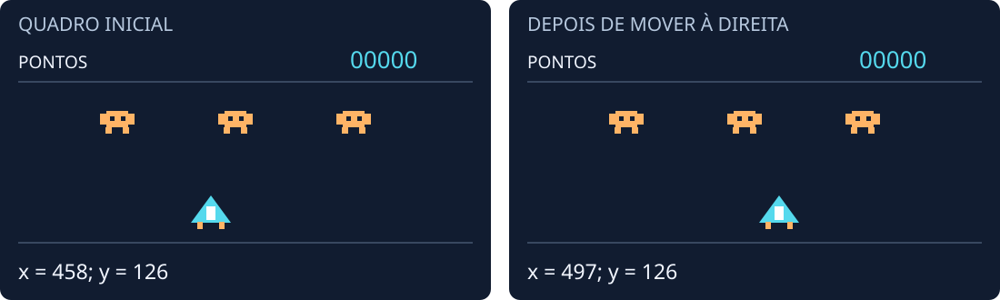
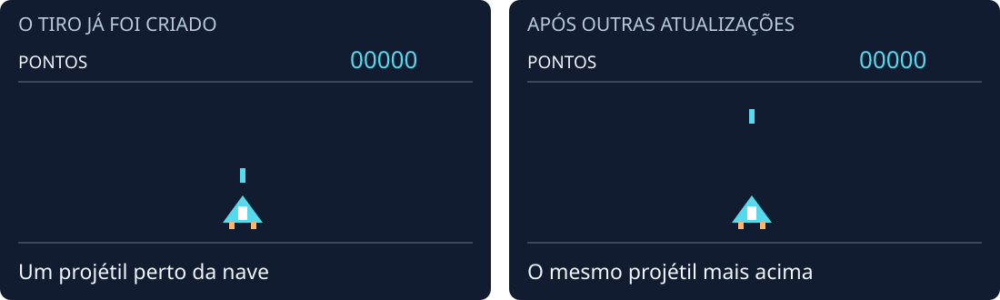
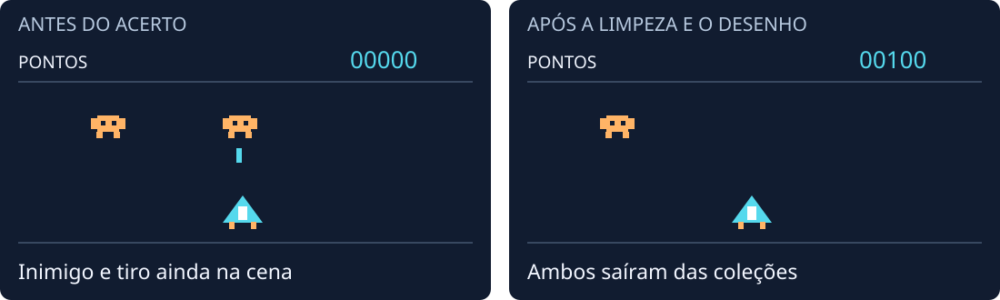

# Aula 20 — Entendendo a estrutura de um jogo orientado a objetos

No Laboratório 19, você começou seu jogo com uma regra própria: um objeto
guarda estado, recebe uma operação e protege um limite. No Megamania,
uma ação pode envolver vários objetos. A nave dispara, o projétil atravessa
a tela, um inimigo é atingido e a partida registra pontos.

Vamos acompanhar essas ações no código para descobrir quem faz cada parte.
Esse caminho ajudará você a consultar o exemplo com uma intenção concreta
ao desenvolver seu próprio jogo.

**Slides:** [Apresentação HTML](../slides/rendered/aula-20-entendendo-a-estrutura-de-um-jogo.html) · [PDF](../slides/rendered/aula-20-entendendo-a-estrutura-de-um-jogo.pdf)

!!! lesson-question "Pergunta da aula"

    Como encontro, no Megamania, uma solução que me ajude a desenvolver meu jogo?

!!! lesson-objectives "Ao final desta aula, você deve conseguir"

    - Seguir um comando até o objeto que altera o estado.
    - Distinguir entrada, apresentação, coordenação e regras dos objetos.
    - Acompanhar criação, permanência e remoção de objetos na partida.
    - Localizar uma colaboração útil ao seu jogo e justificar sua adaptação.

## Começar por uma ação observável

Na pasta do projeto do Lab 19, selecione **Exemplo Megamania** em
**Executar e Depurar** e pressione F5. Enter inicia, A/D ou setas movem,
espaço dispara, P pausa e R reinicia. A base completa está no
[ZIP do Projeto 3](../materiais/projeto-03/base-jogo-poo.zip).

### A cena é uma representação do estado

Observe a nave, os inimigos, os tiros e o placar. Para que essa cena exista,
o programa precisa manter informações: onde cada participante está, quais
continuam na partida e quantos pontos foram registrados.

| O que você vê | Informação que explica a imagem |
| --- | --- |
| Nave em uma posição | `x` e `y` da `Nave`, herdados de `Corpo`. |
| Vários inimigos ou tiros | Referências nas coleções de `Partida`, com a posição de cada participante. |
| Número no placar | `pontos` de `Partida`, consultado pela apresentação. |

O objeto `Nave` guarda estado e executa regras. A figura ciana é sua
representação: `JogoMegamania` consulta o objeto e solicita formas para
mostrá-lo. Uma figura pode combinar várias formas; cada retângulo desenhado
não exige um objeto próprio do modelo. O texto fixo “PONTOS”, por exemplo,
é desenhado pela apresentação; o número ao lado vem do estado da partida.

### Como uma imagem dá lugar à seguinte



Os esquemas desta aula destacam partes da cena; não são capturas nem estão
em escala. Neste movimento, a nave começa em `x = 458`, `y = 126`. Após
dez atualizações de `0.01` segundo para a direita, longe das bordas, termina
em `x = 497`, com o mesmo `y`.

A engine repete o ciclo já visto no Lab 19:

1. Chama `atualizar`: o jogo consulta comandos e encaminha operações que
   podem alterar o estado dos objetos.
2. Chama `desenhar`: a apresentação consulta o estado resultante e solicita
   as formas e os textos daquele quadro.
3. Repete o processo. Posições sucessivas dão a impressão de movimento.

A imagem anterior não é o lugar que guarda a posição da nave. O próximo
quadro é desenhado a partir dos valores mantidos no modelo. Vamos seguir
esse caminho em detalhes, começando pelo movimento e depois acrescentando
criação de objetos e impacto.

### Localizar o código a partir da ação

O código do exemplo fica em
`exemplo-megamania/src/main/java/br/edu/ifpb/jogos/megamania/`.
Comece por `JogoMegamania.java`; as classes das regras ficam na subpasta
`modelo/`. No VS Code, **Ir para Definição** (F12) sobre uma chamada ajuda
a chegar ao método chamado; **Voltar** (Alt + seta esquerda) recupera o
ponto anterior.

Para investigar uma ação, localize quem a solicita, siga a chamada até a
mudança de estado e volte para observar como o resultado é utilizado.
Os trechos desta aula são recortes do exemplo; os métodos completos
continuam nos arquivos indicados.

## Percurso 1 — Da tecla ao movimento da nave

Após o início, com a partida em andamento e sem pausa,
`JogoMegamania.atualizar` traduz o teclado em uma direção:

```java
int direcao = 0;
if (entrada.esquerda()) {
    direcao--;
}
if (entrada.direita()) {
    direcao++;
}

partida.atualizar(segundos, direcao, entrada.acao());
```

A direção vale `-1` para esquerda, `1` para direita e `0` sem deslocamento
horizontal solicitado. Pressionar as duas direções também resulta em `0`.
A partida recebe dados do comando; não precisa conhecer as teclas usadas.

Em `Partida.atualizar`, uma das chamadas é:

```java
nave.atualizar(segundos, direcao);
```

O caminho até aqui é **tecla → direção → partida → nave**. A nave calcula
e protege sua nova posição. Antes de abrir esse cálculo, acompanhe como
o resultado chega ao quadro seguinte.

### Da posição guardada à figura na tela

Em `JogoMegamania.desenhar`, a apresentação recupera a nave da partida:

```java
Nave nave = partida.getNave();
```

Quando a nave deve ficar visível, a chamada é:

```java
desenharNave(tela, nave.getX(), nave.getY());
```

Dentro de `desenharNave`, esta é a forma principal da figura:

```java
tela.triangulo(x, y, x + 22, y + 30, x + 44, y, Cor.CIANO);
```

Os valores consultados na nave chegam aos parâmetros `x` e `y`. A operação
solicita um triângulo cujos três vértices usam essa posição. As outras formas
completam sua aparência. Quando `x` muda no modelo, os vértices são calculados
mais à direita no desenho seguinte. A origem da tela lógica fica embaixo
à esquerda; `x` cresce para a direita e `y`, para cima.

**Leia a cena do esquema:** o segundo quadro mostra a nave mais à direita,
na mesma altura. Qual informação mudou, quem a alterou e quem a consultou
para produzir a imagem? Apenas chamar `desenhar` novamente explicaria isso?

??? "Ver resposta"

    - O `x` da mesma nave mudou de `458` para `497`; `y` permaneceu `126`.
    - `Nave.atualizar`, chamado pela partida, alterou a posição.
    - `JogoMegamania.desenhar` consultou `getX()` e `getY()` e passou os
      valores a `desenharNave`.
    - Apenas desenhar novamente preservaria a posição. O movimento depende
      das atualizações entre os dois quadros.

A nave pode piscar durante a proteção, mas essa escolha visual não altera
sua posição ou suas vidas. Assim, estar momentaneamente invisível também
não significa que o objeto deixou de existir.

### Agora podemos abrir o cálculo do movimento

Em `Nave.atualizar`, a posição é alterada por esta instrução:

```java
posicionar(Math.max(48, Math.min(868, getX() + direcao * 390 * segundos)), getY());
```

A expressão calcula uma nova posição horizontal e a limita entre `48`
e `868`. `Math.min` escolhe o menor valor; `Math.max`, o maior. O `y`
permanece igual. `posicionar` e as consultas de posição são herdados de
`Corpo`, a classe que reúne a geometria dos participantes do jogo.

`segundos` informa o intervalo daquela atualização. Multiplicar a velocidade
por esse intervalo produz o deslocamento. Por exemplo, uma atualização
de `0.01` segundo para a direita desloca a nave `3.9` unidades, se ela
estiver longe das bordas. A engine fornece esse intervalo e limita o passo;
você pode acompanhar a regra sem administrar o relógio da janela.

**Preveja:** a nave está em `x = 867`. Ela recebe uma atualização de
`0.01` segundo com direção `1`. Qual é o novo `x`? Quem impede que ela
saia da área de jogo?

??? "Ver resposta"

    O cálculo produziria `870.9`, mas o limite mantém `x = 868`.
    A regra está em `Nave.atualizar`. A apresentação solicita o movimento;
    a própria nave protege sua posição.

No seu projeto inicial, `MeuJogo.atualizar` chama `Jogador.mover` diretamente.
No Megamania existe uma `Partida` entre a apresentação e os participantes,
pois há vários objetos e consequências para coordenar.

!!! conceito-chave "Conceito-chave — seguir responsabilidades pelas chamadas"

    A entrada informa uma intenção; a coordenação encaminha a ação;
    o objeto responsável altera e protege seu estado; a apresentação
    consulta o resultado para desenhá-lo.

## Percurso 2 — Do espaço pressionado ao projétil em movimento



Na tela, um tiro aparece e depois sobe. Para explicar isso, precisamos
separar três passos: criar um objeto, mantê-lo entre atualizações e desenhar
sua posição atual. Desenhar uma forma, sozinho, não cria um `Projetil` no modelo.

O espaço é consultado por `entrada.acao()`. Enquanto estiver pressionado,
a partida pode receber várias solicitações de disparo. Em `Partida.atualizar`:

```java
if (disparar) {
    Projetil novo = nave.tentarDisparar();
    if (novo != null) {
        projeteis.add(novo);
    }
}
```

A partida solicita o disparo. Para descobrir se ele acontece, seguimos
até `Nave.tentarDisparar`:

```java
public Projetil tentarDisparar() {
    if (!estaVivo() || esperaDisparo > 0) {
        return null;
    }

    esperaDisparo = 0.22;
    return new Projetil(getCentroX() - 3, getY() + getAltura(), true);
}
```

A nave recusa quando está sem vidas ou ainda em recarga. Quando aceita,
reinicia a espera e cria um projétil na posição de saída do disparo.
O último argumento, `true`, identifica um projétil do jogador.

!!! java-focus "Java em foco — um retorno pode indicar ausência de objeto"

    `null` significa que nenhuma referência a objeto foi devolvida.
    O teste `novo != null` permite incluir somente um projétil criado.
    Chamar um método por uma referência `null` causaria uma falha na execução.

O campo `esperaDisparo` pertence à nave. Em `Nave.atualizar`, seu valor
diminui com o tempo, sem ficar negativo:

```java
esperaDisparo = Math.max(0, esperaDisparo - segundos);
```

Isso explica por que manter o espaço pressionado não cria um projétil a cada
atualização. O comando pode se repetir; a regra continua sendo decidida
pelo objeto.

Uma nave nova recebe duas chamadas seguidas de `tentarDisparar`, sem
atualização entre elas. Quantos projéteis são criados? A segunda chamada
substitui o primeiro projétil?

??? "Ver resposta"

    - A primeira chamada cria um projétil e coloca a nave em recarga.
    - A segunda retorna `null`; nenhum segundo projétil é criado.
    - O primeiro objeto continua existindo. A recusa não o substitui.

### Quem mantém o projétil depois da chamada?

Em `Partida`, a coleção é um campo:

```java
private final List<Projetil> projeteis = new ArrayList<>();
```

`projeteis.add(novo)` guarda uma referência ao objeto devolvido pela nave.
O término da chamada não apaga esse objeto: a partida continua tendo acesso
a ele pela lista. `final` impede reatribuir o campo a outra lista; ainda é
possível acrescentar e remover elementos da lista existente.

Em cada atualização, a partida percorre a coleção e chama
`projetil.atualizar(segundos)`. O próprio projétil altera sua posição e
marca-se como inativo quando sai da área. Depois, a apresentação percorre
`partida.getProjeteis()` para desenhar os objetos que permaneceram na lista.

Este recorte de `JogoMegamania.desenhar` mostra a forma principal de cada tiro:

```java
for (Projetil projetil : partida.getProjeteis()) {
    Cor cor = projetil.isDoJogador() ? Cor.CIANO : Cor.LARANJA;
    tela.retangulo(projetil.getX(), projetil.getY(), 6, 16, cor);
}
```

A expressão com `?` escolhe ciano para um projétil do jogador e laranja
para um projétil inimigo. A cada passagem do laço, a apresentação consulta
um participante e solicita seu retângulo. O código completo também desenha
um contorno. O mesmo objeto pode aparecer em muitos quadros, em posições
diferentes; não é necessário criar outro projétil para cada imagem.

Se a lista fosse substituída por uma lista vazia a cada atualização, o que
aconteceria com os disparos já em movimento?

??? "Ver resposta"

    A partida perderia as referências aos projéteis anteriores e deixaria
    de atualizá-los e desenhá-los por essa coleção. Criar a lista uma vez
    e manter os participantes entre atualizações permite sua continuidade.

O caminho completo é: **solicitar → decidir → criar → guardar → atualizar
→ desenhar**. No seu jogo, esse mesmo raciocínio pode ajudar a acompanhar
objetos criados durante a partida, mesmo que eles não sejam tiros.

## Percurso 3 — Do impacto à pontuação



Considere um acerto isolado, sem outros impactos nessa atualização. Na tela,
o inimigo e o tiro desaparecem e o placar passa de `00000` para `00100`.
Vamos decompor essa mudança: verificar o encontro, alterar os participantes,
registrar pontos, limpar as coleções e desenhar o novo estado.

Mover um projétil não garante que ele tenha atingido alguém. Depois de
atualizá-lo, `Partida` investiga os possíveis alvos. Para um projétil do
jogador, o recorte é:

```java
for (Inimigo inimigo : inimigos) {
    if (projetil.tentarAtingir(inimigo)) {
        pontos += inimigo.getPontos();
    }
}
```

A partida conhece os inimigos e a pontuação. A tentativa de impacto
pertence ao projétil:

```java
public boolean tentarAtingir(Alvo alvo) {
    if (!ativo || !alvo.estaVivo() || !alvo.colideCom(this)) {
        return false;
    }

    alvo.receberImpacto();
    ativo = false;
    return true;
}
```

Para aceitar a tentativa, o projétil precisa estar ativo, o alvo precisa
estar vivo e os corpos precisam se sobrepor. `this` fornece ao alvo uma
referência ao próprio projétil para verificar a colisão. A geometria fica
em `Corpo.colideCom`; aqui basta acompanhar o resultado dessa consulta.

O parâmetro usa o contrato `Alvo`, que oferece `estaVivo`, `colideCom` e
`receberImpacto`. `Inimigo` e `Nave` cumprem esse contrato e herdam de
`Corpo` a implementação da colisão. O efeito de receber um impacto depende
do objeto concreto. No inimigo:

```java
public void receberImpacto() {
    vivo = false;
}
```

A nave tem outra regra, com vidas e proteção temporária. A operação comum
permite solicitar o impacto sem copiar o efeito particular de cada alvo
para `Projetil`.

### Um retorno comunica o resultado da colaboração

Considere dois inimigos vivos sobrepostos e um projétil ativo na mesma
região, como neste cenário independente de janela:

```java
Inimigo primeiro = new Inimigo(100, 200);
Inimigo segundo = new Inimigo(100, 200);
Projetil tiro = new Projetil(110, 205, true);

boolean acertouPrimeiro = tiro.tentarAtingir(primeiro);
boolean acertouSegundo = tiro.tentarAtingir(segundo);
```

Quais são os dois retornos? Quais inimigos permanecem vivos?

??? "Ver resposta"

    - `acertouPrimeiro` vale `true`; o primeiro inimigo fica morto e o
      projétil fica inativo.
    - `acertouSegundo` vale `false`, pois o projétil já está inativo.
      O segundo inimigo permanece vivo.

    Esse cenário já aparece no teste
    `umProjetilNaoAtingeDoisAlvosSobrepostos`, em
    `exemplo-megamania/src/test/java/br/edu/ifpb/jogos/megamania/modelo/PartidaTest.java`.
    Ele verifica a colaboração criando os objetos diretamente, sem janela.

Ao receber `true`, a partida acrescenta os `100` pontos devolvidos por
`Inimigo.getPontos()`. No percurso do disparo do jogador, o retorno
informa que aquela tentativa foi aceita. A pontuação permanece na partida;
o inimigo não precisa conhecer o placar.

### Ficar inativo e sair da lista são passos diferentes

O projétil altera `ativo`; o inimigo altera `vivo`. Eles continuam nas
coleções até a etapa de limpeza em `Partida.atualizar`:

```java
for (int i = inimigos.size() - 1; i >= 0; i--) {
    if (!inimigos.get(i).estaVivo()) {
        inimigos.remove(i);
    }
}

for (int i = projeteis.size() - 1; i >= 0; i--) {
    if (!projeteis.get(i).estaAtivo()) {
        projeteis.remove(i);
    }
}
```

!!! java-focus "Java em foco — remover vários elementos por índice"

    `size() - 1` é o último índice da lista. `get(i)` consulta a referência
    nessa posição e `remove(i)` retira essa posição. Ao percorrer de trás
    para a frente, a remoção não muda os índices menores ainda por visitar.
    Em uma lista vazia, `i` começa em `-1` e o corpo não executa.

A limpeza ocorre depois do percurso de impactos. Assim, as listas não
mudam de tamanho durante aquela investigação. Remover uma referência da
lista não transforma o objeto em `null` nem apaga outras referências a ele.

Por fim, a partida decide seu estado:

```java
if (!nave.estaVivo() || invasoresChegaram()) {
    estado = Estado.DERROTA;
} else if (inimigos.isEmpty()) {
    estado = Estado.VITORIA;
}
```

`Estado` é um `enum`: um tipo com valores nomeados, aqui `JOGANDO`,
`VITORIA` e `DERROTA`. `isEmpty()` consulta se a lista está vazia.
O método `invasoresChegaram` verifica se um inimigo alcançou a altura da nave.
Como a derrota é verificada primeiro, ela tem precedência se as condições
de derrota e vitória ocorrerem na mesma atualização.

Suponha que reste um inimigo e um projétil o atinja. A nave continua viva
e não há invasão. Quem decide a vitória e em que momento?

??? "Ver resposta"

    A partida decide após remover o inimigo morto da coleção. A lista
    fica vazia e, como não há condição de derrota, o estado passa a
    `VITORIA`. `Inimigo.receberImpacto` cuida apenas do estado do inimigo.

Nas atualizações seguintes, `Partida.atualizar` retorna sem avançar suas
regras quando o estado não é `JOGANDO`. A apresentação consulta o estado
para mostrar o painel correspondente.

### Fechar o caminho: o que será desenhado depois do impacto?

O esquema inicial compara o quadro anterior ao acerto com o quadro produzido
depois da atualização completa. Nesse segundo quadro:

| Mudança no modelo | Consequência na apresentação |
| --- | --- |
| `pontos` passa de `0` para `100`. | `getPontos()` fornece o novo número ao desenho do placar. |
| O inimigo morto sai de `inimigos`. | O laço de desenho não encontra mais esse inimigo. |
| O projétil inativo sai de `projeteis`. | O laço de desenho não encontra mais esse tiro. |

Em `JogoMegamania.desenhar`, o placar é produzido por este trecho:

```java
tela.texto(String.format("%05d", partida.getPontos()),
        556, 659, 1.5, Cor.CIANO);
```

`String.format("%05d", ...)` apresenta o inteiro com pelo menos cinco
dígitos, completando com zeros à esquerda. Ele transforma `100` em `00100`
para exibição; quem alterou os pontos foi a partida.

O mesmo princípio explica o desaparecimento: a apresentação percorre as
coleções atuais. Ela não precisa receber uma ordem para apagar cada figura
antiga. A engine limpa o quadro anterior e o jogo desenha a cena novamente.
Isso também preserva a distinção entre sair da cena e deixar de existir:
remover uma referência da coleção não apaga outras referências ao objeto.

!!! synthesis "Síntese — uma consequência atravessa vários objetos"

    - O projétil verifica a tentativa e solicita o impacto.
    - O alvo aplica seu efeito particular.
    - A partida registra pontos, remove participantes e avalia o término.
    - A apresentação representa o estado resultante.

## O mapa que as execuções revelaram

Agora podemos localizar as partes do jogo a partir do que observamos:

| Parte | Responsabilidade | Referência no projeto |
| --- | --- | --- |
| Infraestrutura | Janela, ciclo, teclado e operações de desenho. | `engine/`, fornecida pronta. |
| Apresentação e entrada | Traduzir comandos e representar o estado; no exemplo, controlar também início e pausa. | `JogoMegamania`. |
| Coordenação | Manter participantes, encaminhar atualizações, registrar pontos e decidir término. | `modelo/Partida`. |
| Participantes | Guardar estado e executar regras próprias. | `modelo/Nave`, `Inimigo` e `Projetil`. |

`Partida` não importa teclado, janela ou biblioteca gráfica. Isso permite
investigar suas regras sem abrir o jogo. `JogoMegamania` cumpre o contrato
`Jogo`, pelo qual a engine chama `atualizar` e `desenhar`. A engine também
consegue executar `MeuJogo`, que cumpre o mesmo contrato.

Uma classe coordenadora ajuda quando existem relações a administrar.
Ela não precisa concentrar todas as decisões: a recarga continua na nave,
a condição de atividade no projétil e a condição de vida no alvo.

## Usar o exemplo para evoluir seu jogo

No seu jogo, os nomes e as mecânicas podem ser diferentes. Use o exemplo
para procurar uma responsabilidade ou uma colaboração de que você precisa.

O Projeto 3 permite **IA Nível 3 — Colaborador**: a IA pode ajudar na leitura
e na geração de código. Ao incorporar uma sugestão, você continua responsável
por compreender, verificar e conseguir modificar o comportamento.

| Se a intenção for… | Investigue no Megamania… | Adapte ao seu domínio… |
| --- | --- | --- |
| Acionar uma operação com condição de aceitação | A solicitação e a decisão em `tentarDisparar`. | Quem recebe o comando e quem pode recusá-lo. |
| Criar participantes que continuam na cena | A inclusão e a atualização de `projeteis`. | Quem guarda os objetos e quando saem da partida. |
| Produzir um efeito entre dois objetos | `tentarAtingir` e `receberImpacto`. | A condição da interação e o efeito em cada participante. |
| Mostrar uma consequência coletiva | A pontuação e o estado de `Partida`. | Quem reúne informação suficiente para decidir o resultado. |

Considere um jogo de exploração: o personagem encontra um recurso e o
recolhe. A coleta aumenta seu saldo e torna o recurso indisponível. Uma
segunda tentativa sobre o mesmo recurso deve preservar o saldo.

Qual percurso do Megamania ajuda a investigar essa interação? Que
responsabilidades você procuraria no seu modelo?

??? "Ver uma análise possível"

    O percurso do impacto ajuda a separar condição, efeito e consequência.
    É necessário verificar a disponibilidade do recurso, aplicar o aumento
    de saldo e impedir uma nova coleta. Um coordenador pode reunir os
    participantes e encaminhar a operação; os objetos devem proteger as
    regras de seu estado.

    A solução precisa verificar coleta aceita e tentativa repetida, observando
    saldo e disponibilidade. Ela não exige criar um projétil ou declarar
    que o recurso é um `Alvo`. O contrato só faz sentido se suas operações
    corresponderem ao domínio.

Agora escolha uma evolução pequena que você deseja para seu jogo. Identifique:

1. O comportamento desejado e um resultado que permita verificá-lo.
2. O trecho do Megamania que oferece referência para essa evolução.
3. Quem solicita a operação, quem decide sua validade e quem guarda o resultado.
4. Um cenário permitido e uma recusa ou limite para verificar sem janela.

??? "Conferir seu recorte"

    Um recorte útil dá nomes aos participantes e resultados concretos.
    Por exemplo: “Um recurso disponível fornece uma unidade ao personagem;
    repetir a tentativa não acrescenta outra unidade. Vou consultar o
    percurso do impacto e verificar saldo e disponibilidade em dois cenários.”

    “Vou copiar a classe `Partida`” ainda não delimita um comportamento.
    Seu recorte pode usar outra mecânica, desde que consiga localizar
    a colaboração relevante e definir como conferir seu resultado.

Essas anotações são apoio de estudo. Continue trabalhando no projeto do
Lab 19, preservando sua regra e seus testes. Ao consultar o exemplo, siga
uma execução completa antes de incorporar um trecho ao seu jogo.

!!! synthesis "Síntese — consultar código com uma intenção"

    - Parta de um comportamento e acompanhe chamadas e mudanças de estado.
    - Diferencie a regra de cada participante das consequências da partida.
    - Aproveite o raciocínio do exemplo e adapte os objetos ao seu domínio.
    - Verifique o resultado observado e os limites da operação.

## Materiais relacionados

- [Base do Projeto 3 — ZIP](../materiais/projeto-03/base-jogo-poo.zip): jogo inicial, engine, Megamania e testes.
- [Laboratório 19 — Iniciando seu jogo](laboratorio-19-iniciando-seu-jogo.md): ponto de partida dos projetos individuais.
- [Aula 07 — Um objeto coordenando vários outros](aula-07-um-objeto-coordenando-varios-outros.md): coleções e coordenação.
- [Aula 13 — Como saber se ainda funciona?](aula-13-como-saber-se-ainda-funciona.md): cenários e verificação com JUnit.
- [Aula 15 — Polimorfismo: a mesma mensagem, comportamentos diferentes](aula-15-polimorfismo-a-mesma-mensagem-comportamentos-diferentes.md): contrato e efeito no objeto concreto.
- [Aula 18 — Compartilhando regras sem perder os contratos](aula-18-compartilhando-regras-sem-perder-os-contratos.md): comportamento herdado e interfaces.
- [Java essencial](../materiais/java-essencial.md): referência de linguagem para acompanhar os trechos.
