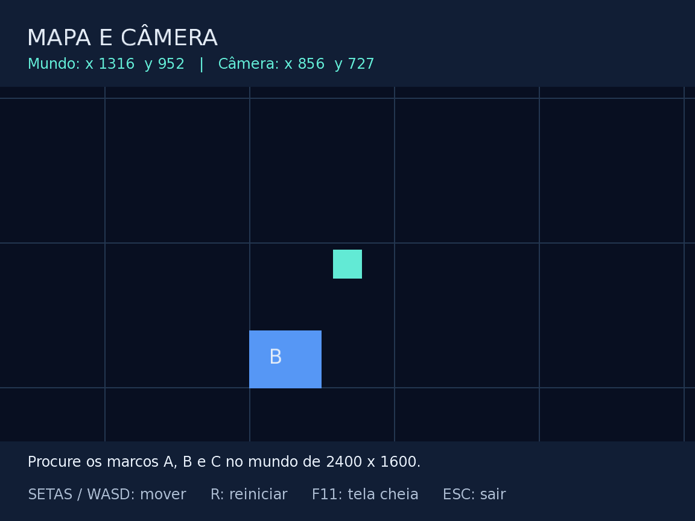
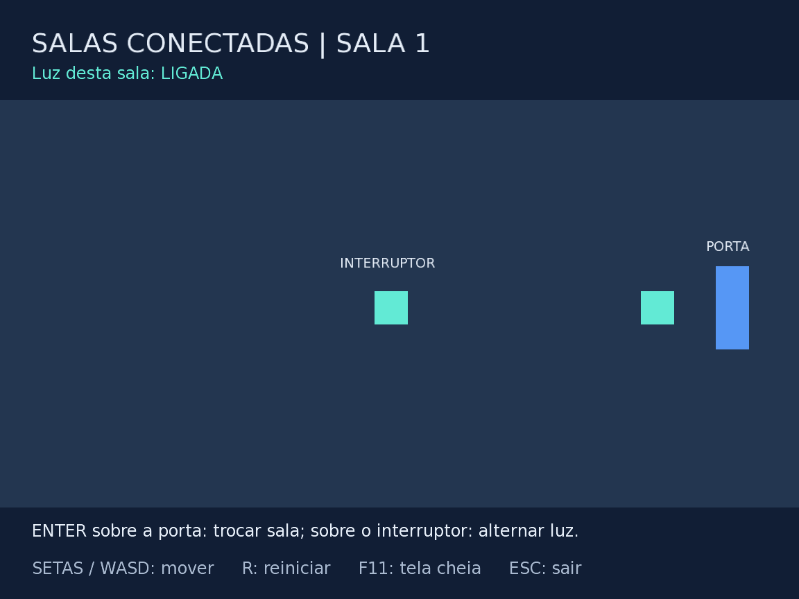
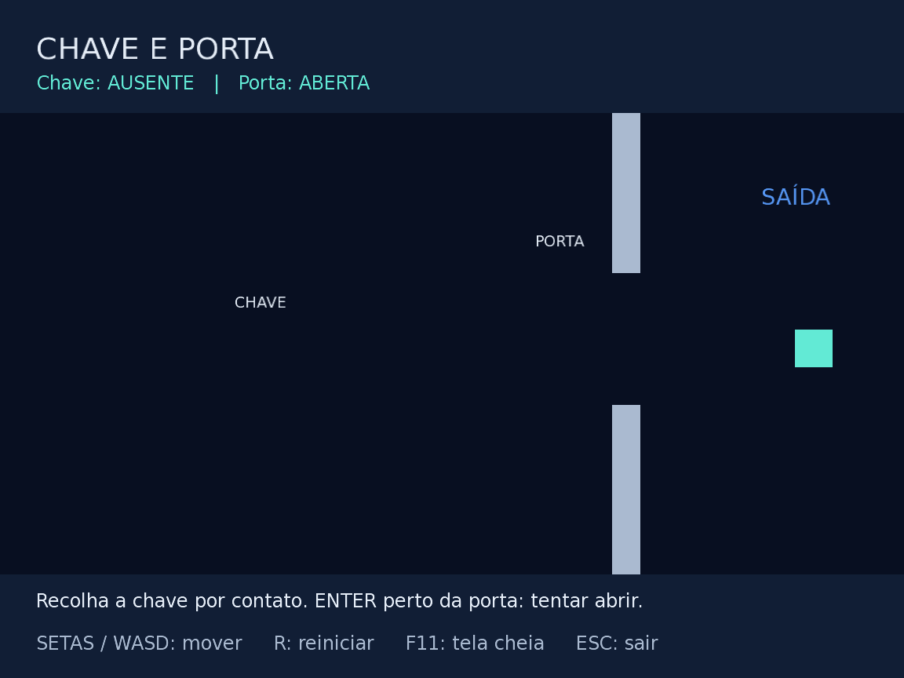
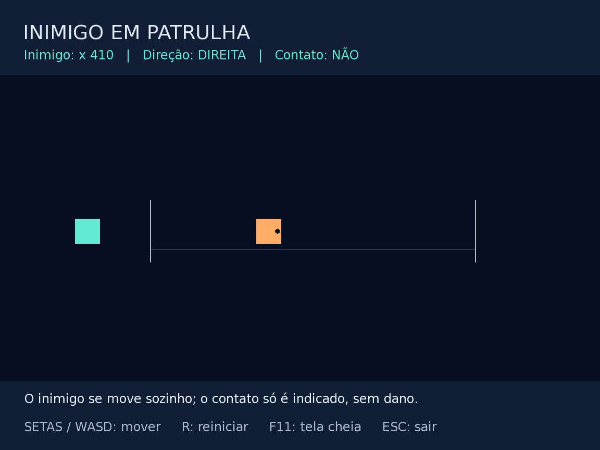

# Exemplos para o seu jogo

Escolha um comportamento que você deseja acrescentar ao seu projeto. Os quatro
exemplos abaixo são pequenas demonstrações independentes, com o mesmo jogador
ciano, controles e organização de código. Todos usam a engine já fornecida.

**[Baixar a base com os exemplos — ZIP](base-jogo-poo.zip)**

Se você já desenvolveu seu jogo, extraia esse ZIP em **outra pasta para
consulta**. Preserve seu projeto atual. Abra a raiz `meu-jogo` no VS Code,
aguarde a importação Java e selecione uma das opções abaixo em
**Executar e Depurar → F5**.

| Para experimentar… | Selecione… | Guia incluído no ZIP |
| --- | --- | --- |
| [Mundo maior que a tela](#mapa-e-camera) | Exemplo — Mapa e câmera | `exemplo-mapa/README.md` |
| [Mudança de ambiente](#salas-conectadas) | Exemplo — Salas conectadas | `exemplo-salas/README.md` |
| [Uma passagem que exige um item](#chave-e-porta) | Exemplo — Chave e porta | `exemplo-chave-porta/README.md` |
| [Movimento autônomo](#inimigo-em-patrulha) | Exemplo — Inimigo em patrulha | `exemplo-patrulha/README.md` |

Setas/WASD movem; R reinicia; Esc fecha; F11 alterna tela cheia. Enter
interage nas salas e na porta. Encerre a execução anterior antes de abrir
outro exemplo. O [Laboratório 19](../../aulas/laboratorio-19-iniciando-seu-jogo.md)
apresenta a preparação do ambiente e a execução da base.

## Mapa e câmera

O mundo mede **2400 × 1600**, com três marcos visuais. Caminhe para a direita
e para cima: a câmera começa a acompanhar o jogador, enquanto o painel e os
controles permanecem fixos. Nas bordas do mundo, a câmera para.

O painel mostra a posição do jogador **no mundo** e a origem da câmera.
A faixa visível do mapa mede 960 × 490; o restante da tela é reservado aos
painéis. Os marcos servem para observar o deslocamento; não bloqueiam movimento.

Para localizar o comportamento, acompanhe `JogoMapa.atualizar`, `Mundo.mover`
e `Camera.acompanhar`. Em `desenhar`, compare a conversão usada nos objetos
do mundo com as coordenadas fixas do painel.

Ao adaptar, preserve as posições do seu modelo no mundo e faça a conversão
apenas no desenho. Colisões continuam usando as posições do mundo. O guia
identifica as dependências entre `Mundo`, `Jogador` e `Camera`; não é preciso
alterar a engine ou aumentar a janela.

## Salas conectadas

Na primeira sala, vá até o interruptor central e pressione Enter. Depois,
vá até a porta azul à direita e use Enter para entrar na segunda sala.
Sua luz é independente. Volte pela porta à esquerda e confira que a primeira
sala manteve seu estado.

`Partida` mantém duas instâncias de `Sala`. A transição troca a referência da
sala atual e reposiciona o mesmo jogador, sem recriar o ambiente visitado.
O ponto de chegada fica afastado da porta.

Esse comportamento ajuda a organizar fases, cômodos e áreas de exploração.
Ao adaptar, defina o destino de cada passagem, a posição de chegada e quais
informações devem persistir quando um ambiente sai da tela.

## Chave e porta

Uma parede divide a área. Primeiro, tente passar ou abrir a porta sem a chave.
Depois, encoste na chave laranja, vá até a porta e pressione Enter. A chave
é consumida, a passagem fica livre e as partes fixas da parede continuam
bloqueando o movimento. R restaura o estado inicial.

`Chave` controla sua disponibilidade, `Jogador` guarda a posse do item e
`Porta` decide se pode abrir. `Partida` coordena movimento, coleta e proximidade.
O modelo verifica a travessia de uma parede vertical específica; não é um
sistema completo de física. Há uma única chave, sem inventário geral.

Você pode aproveitar só a colaboração de posse e consumo, adaptando-a ao
inventário do seu jogo. O guia também indica como preservar o bloqueio caso
você use a parede deste exemplo.

## Inimigo em patrulha

Sem pressionar teclas, observe o inimigo laranja caminhar entre dois limites
e inverter a direção. Mova o jogador até sua trajetória: o painel indica
contato, sem causar dano. Assim, é possível observar o movimento autônomo
sem misturá-lo a outras regras.

`Inimigo.atualizar` recebe apenas o tempo decorrido. `Partida.atualizar`
atualiza jogador e inimigo; a apresentação consulta os estados para desenhar.
O inimigo não precisa conhecer teclado ou janela.

Para adaptar só a patrulha, a classe `Inimigo` pode ser usada sem as outras
classes do modelo. Configure limites e velocidade e encaminhe a atualização
no ciclo do seu jogo. Perseguição e dano são evoluções separadas.

## Localizar, testar e reaproveitar

Cada pasta possui `Iniciar...`, `Jogo...`, `modelo/`, testes e um README.
O arquivo `EXEMPLOS.md`, na raiz do ZIP, reúne os atalhos e um roteiro comum:

1. Execute e siga as observações do guia do exemplo escolhido.
2. Siga uma chamada da entrada até o objeto que altera o estado.
3. Localize os testes e confira o comportamento sem abrir a janela.
4. Leia as classes necessárias e adapte a colaboração ao seu modelo.
5. Integre atualização, desenho e reinício e verifique o resultado.

Se copiar classes para `src/main/java/meujogo/`, ajuste `package` e imports.
Se seu projeto já tem um jogador ou inventário, aproveite esses objetos.
Não copie os arquivos de build, a engine ou as configurações por cima do jogo
em andamento. Os exemplos são referências; não é necessário reunir todos
os mecanismos no mesmo projeto.

Para executar os testes, use **Terminal → Executar Tarefa → Verificar todos
os jogos e exemplos**. O README também apresenta comandos por exemplo.
As dependências e a configuração de JUnit já fazem parte da base.

O [Megamania](../../aulas/aula-20-entendendo-a-estrutura-de-um-jogo.md)
continua disponível para investigar uma aplicação com mais colaborações.
