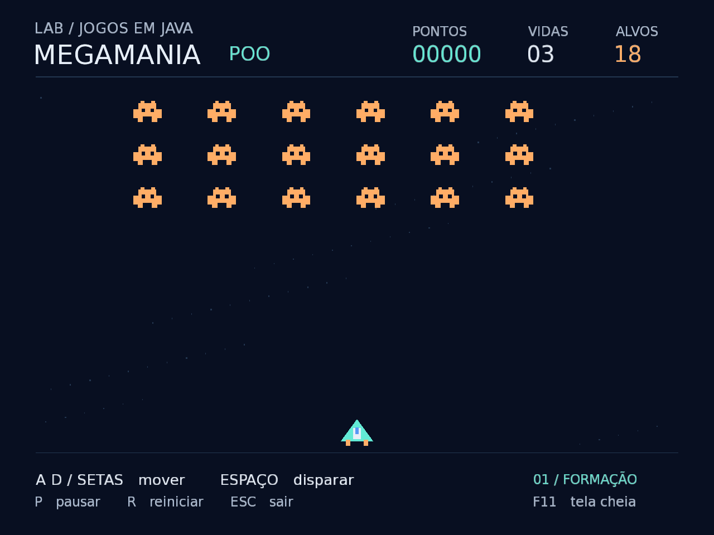

# Jogos Java — protótipo Megamania POO

Protótipo para o professor jogar, avaliar e ajustar antes de definir o material
da Unidade 03. Usa **libGDX 1.14.2** para janela, teclado e desenho. A inspiração
é um jogo de nave e formação de inimigos; não é uma reprodução fiel de Megamania.
Os desenhos são feitos com formas geométricas, sem imagens ou sons externos.
A fonte DejaVu Sans e sua licença estão incluídas em `src/main/resources/fontes/`.



## Executar

Requisito: **JDK 17 ou superior**, com `java` disponível no terminal ou
`JAVA_HOME` apontando para a JDK. A referência da disciplina é Java 25.
Não é necessário instalar Gradle: o wrapper está incluído.
A primeira execução precisa de internet para baixar Gradle e as bibliotecas.

No Linux/macOS, a partir da raiz deste repositório:

```bash
cd prototipos/megamania-poo
./gradlew run
```

No Windows (PowerShell), entre na mesma pasta e execute:

```powershell
.\gradlew.bat run
```

No IntelliJ IDEA, abra **esta pasta** como projeto Gradle, escolha uma JDK e
execute a tarefa `application > run`. O terminal da IDE também aceita os comandos
acima. O suporte a macOS inclui a opção `-XstartOnFirstThread` na tarefa `run`.

### Aplicar alterações no código

Para recompilar e reabrir automaticamente ao salvar, no **Linux/macOS**, use:

```bash
./dev.sh
```

O modo de desenvolvimento observa `src/main` e a configuração do Gradle.
Ao salvar uma alteração, fecha a janela anterior, compila e abre o jogo
atualizado em uma **partida nova**. Se a compilação falhar, o erro aparece no
terminal; corrija e salve para tentar novamente. Fechar a janela ou pressionar
`Ctrl+C` no terminal encerra esse modo. Para o segundo exemplo, use
`./dev.sh base`. O script funciona também quando chamado de outra pasta.

O comando `./gradlew run` compila os arquivos salvos em `src/main/java` antes
de abrir o jogo. Para aplicar uma alteração, salve o arquivo, feche a janela
atual e execute o comando novamente. A tecla **R** cria outra partida com o
código já carregado; ela não recompila nem recarrega as classes Java.

Se uma alteração não aparecer mesmo após abrir novamente, confira se o terminal
está nesta pasta e se o arquivo foi salvo. Para forçar uma compilação completa:

```bash
./gradlew clean run
```

O executável em `build/install/megamania-poo/bin/` usa uma cópia empacotada do
código. Se estiver usando essa distribuição, feche o jogo e execute
`./gradlew installDist` novamente antes de abri-la. Durante os ajustes no código,
use `./dev.sh` para atualização automática ou `./gradlew run` para recompilar a
cada execução. No Windows, substitua `./gradlew` por `.\gradlew.bat`.

## Controles e regras deste protótipo

| Tecla | Ação |
| --- | --- |
| Enter | Iniciar |
| A/D ou setas esquerda/direita | Mover a nave |
| Espaço, mantendo pressionado | Disparar, respeitando o intervalo entre tiros |
| P | Pausar ou continuar |
| R | Iniciar uma partida nova, inclusive durante pausa ou fim de jogo |
| F11 | Alternar entre janela e tela cheia |
| Esc | Fechar |

- A partida tem 18 inimigos de um único tipo e três vidas.
- A formação move-se lateralmente e desce ao encontrar uma borda.
- Inimigos disparam periodicamente. Cada impacto retira uma vida; a nave fica
  protegida por 1,5 segundo após ser atingida e pisca nesse intervalo.
- Cada inimigo eliminado vale 100 pontos. Um projétil atinge apenas um alvo.
- Eliminar todos os inimigos produz vitória. Perder as vidas ou deixar a
  formação chegar à altura da nave produz derrota.
- Vitória, derrota e pausa interrompem as regras da partida. Não há novas ondas
  automáticas: novas ondas são uma possível evolução.
- O jogo abre maximizado. Em modo janela, o tamanho inicial de referência é
  1280 × 960, limitado ao tamanho do monitor. A janela pode ser redimensionada e
  mantém a proporção do campo, com faixas nas laterais em telas mais largas.
- Os textos são gerados no tamanho correspondente à resolução da janela,
  considerando também os pixels adicionais de monitores HiDPI. F11 alterna
  para tela cheia; ao retornar, recupera o tamanho anterior da janela.

Esses valores são regras experimentais do protótipo, ajustáveis após jogarmos;
não constituem requisitos de entrega ou regras acadêmicas.

## Estrutura e leitura do código

Todos os pacotes ficam em `src/main/java/br/edu/ifpb/jogos/`:

| Pacote | Responsabilidade |
| --- | --- |
| `base` | Contratos pequenos de jogo, entrada e desenho, comuns a jogos diferentes |
| `desktop` | Adaptadores de libGDX, janela, teclado e ciclo de atualização; infraestrutura fornecida |
| `megamania.modelo` | Estado, regras, colisões, movimento e colaboração entre objetos |
| `megamania` | Apresentação do exemplo e tradução das teclas em comandos da partida |
| `meujogo` | Segundo exemplo mínimo, independente das regras de nave e inimigos |

Comece por `Principal`, que entrega um `Jogo` à `Aplicacao`. A cada quadro,
`Aplicacao` chama `atualizar(segundos, entrada)` e `desenhar(tela)` pelo contrato.
Em `JogoMegamania`, acompanhe a tradução da entrada para `Partida.atualizar`.
Depois siga um disparo: `Nave` → `Projetil` → `Alvo` → remoção e pontuação.

O domínio não importa libGDX. É possível executar os testes de regras sem janela.
As listas consultadas não permitem adição/remoção externa, mas seus elementos
são referências aos mesmos objetos da partida, e não cópias imutáveis.

Exemplos de POO presentes:

- `Partida` coordena; `Nave` protege vidas e recarga; `Projetil` controla seu uso.
- `Alvo` é uma capacidade implementada por nave e inimigo. O projétil solicita
  impacto pelo contrato; não testa a classe concreta do alvo.
- `Corpo` compartilha posição, dimensões e colisão com estado privado; as
  subclasses usam o construtor da base e suas operações protegidas.
- `MovimentoFormacao` é recebido por composição. `MovimentoLateral` é a primeira
  implementação; outro movimento pode ser recebido sem mudar os inimigos.
- Argumentos inválidos provocam `IllegalArgumentException`; uma recarga ainda
  ativa recusa o disparo normalmente, devolvendo `null`, sem lançar exceção.

Essa é uma arquitetura inicial para comparação e evolução. Não é preciso
forçar todos os jogos a ter inimigos, projéteis ou uma hierarquia de `Corpo`.

## Começar outro jogo a partir da mesma base

Execute o segundo exemplo, que apenas move um quadrado em duas dimensões:

```bash
./gradlew run --args=base
```

No Windows, use `.\gradlew.bat run --args=base`.

1. Faça uma cópia desta pasta, preservando o wrapper e a configuração.
2. Comece pelo pacote `meujogo`: `MeuJogo` implementa o mesmo contrato `Jogo`.
3. Crie os objetos e as regras do novo domínio em classes próprias.
4. Em `Principal`, escolha o novo objeto `Jogo` que a aplicação deve executar.
5. Reutilize `base` e `desktop`; o pacote `megamania` fica como referência e
   não é necessário para executar `MeuJogo`.

O desenho usa coordenadas de **960 × 720**, com origem no canto inferior esquerdo;
`y` cresce para cima. `atualizar` recebe segundos, portanto movimento deve usar
velocidade multiplicada pelo tempo. A infraestrutura limita cada passo a 1/30 s.
O excesso de tempo é descartado em travamentos; trata-se de uma simplificação
para este protótipo. Os jogos recebem teclas contínuas e eventos de um quadro
por `Entrada`. `Tela` oferece retângulos, círculos, triângulos e texto.
Essas coordenadas são independentes da resolução da janela. A infraestrutura
ajusta o desenho e usa a extensão `gdx-freetype` para gerar fontes nítidas em
cada tamanho, sem precisar instalar fontes na máquina do jogador.

A base atende jogos 2D simples como Pong, coleta/desvio, arena ou nave. Imagens,
áudio, mouse e física podem exigir estender essa infraestrutura; libGDX oferece
esses recursos, mas não foram necessários nesta primeira versão.

## Verificar e distribuir

```bash
./gradlew test
./gradlew installDist
```

O primeiro comando executa os testes JUnit. O segundo gera scripts e bibliotecas
em `build/install/megamania-poo/`, que podem ser copiados juntos para outra
máquina com Java. No Linux/macOS, execute `bin/megamania-poo`; no Windows,
`bin/megamania-poo.bat`. A distribuição ainda requer uma JDK/JRE compatível.

Verificado em Linux com Java 25: 14 testes de regras e execução gráfica em tela
virtual, incluindo início, movimento, pausa, reinício, saída e o segundo exemplo.
O redimensionamento e os limites dos textos foram verificados em 640 × 480,
960 × 720, 1280 × 960 e 1920 × 1080, assim como F11 e o retorno ao tamanho anterior.
Os inicializadores de Windows e macOS estão configurados, mas ainda precisam de
verificação nesses sistemas.

Possibilidades para avaliar depois: novos movimentos, outro disparo, ondas e
itens temporários. A liberdade para cada aluno desenvolver seu jogo foi proposta
pelo professor; critérios, entregas e sequência pedagógica ainda serão definidos.

## Referências técnicas

- [libGDX — criação de projetos](https://libgdx.com/wiki/start/project-generation)
- [libGDX — um jogo simples](https://libgdx.com/wiki/start/a-simple-game)
- [libGDX — fontes TrueType com FreeType](https://libgdx.com/wiki/extensions/gdx-freetype)
- [Gradle — compatibilidade com Java](https://docs.gradle.org/9.1.0/userguide/compatibility.html)

As versões estão fixadas em `build.gradle` e no wrapper. Gradle e libGDX são
infraestrutura fornecida, sem exigir que sejam conteúdos formais da disciplina.
O backend LWJGL está fixado em 3.4.0 para compatibilidade com Java 25; os
inicializadores habilitam o acesso nativo necessário às bibliotecas gráficas.
